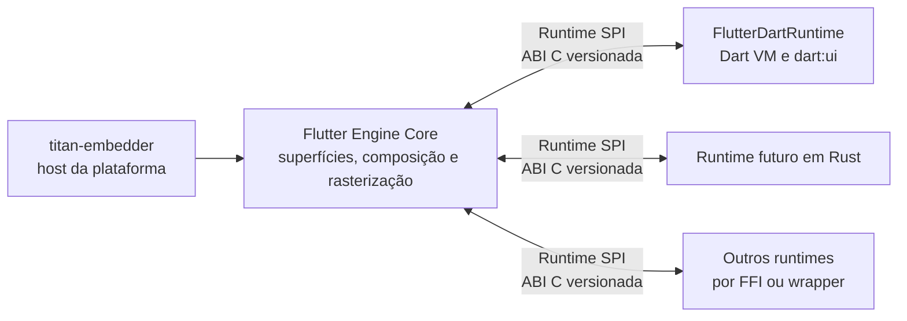

# Estudo: Flutter Engine com SPI de runtime neutro (Dart opcional)

**Data:** 2026-10-14
**Status:** desenho aprovado; implementação futura (meta 3 do `titan-flutter-engine`)
**Escopo:** o contrato entre o núcleo gráfico do engine e os runtimes de UI. A implementação de um framework Rust
fica para outro estudo.

## Contexto

O `titan-embedder` do TitanDM é escrito em Rust e integra o host ao Flutter Engine pela Embedder API C. Essa
fronteira cobre inicialização, superfícies, métricas, entrada, vsync, mensagens de plataforma e apresentação. Ela
**não** torna o runtime Dart opcional: o engine cria a Dart VM e o isolate raiz, e o framework Flutter conversa com o
C++ interno por `dart:ui`.

A meta é que o engine continue executando apps Flutter em Dart e, numa configuração de build alternativa, possa ser
compilado **sem construir, linkar ou empacotar o runtime Dart**. Um runtime futuro, começando por Rust, usaria uma
interface neutra para produzir cenas e semântica. A fronteira não é específica de Rust, .NET, Dart ou de um
framework.

## Objetivos

- Isolar as dependências de Dart num backend opcional.
- Preservar o fluxo e o comportamento dos apps Flutter em Dart quando esse backend está habilitado.
- Definir uma ABI C versionada para runtimes que não dependam de Dart.
- Permitir que outros runtimes usem o núcleo gráfico sem expor tipos privados do engine.
- Manter compositor, sessão, lock e demais processos do TitanDM fora do processo do runtime de UI.

## Fora de escopo

- Implementar agora um framework Flutter em Rust ou em outra linguagem.
- Prometer que pacotes ou código Dart executem em outros runtimes.
- Replicar widgets, layout, animações ou APIs do framework Flutter.
- Isolamento de processos para runtimes neste primeiro desenho.
- Definir todas as primitivas gráficas e serviços de plataforma da ABI em nível de código.

## Decisões

1. O Engine será dividido entre `libflutter_engine_core.so`, sem Dart e com
   o core gráfico, e `libflutter_engine.so`, o `flutterDartEngine` que mantém a
   Dart VM, `dart:ui`, snapshots e a Embedder API atual. A opção de build com
   Dart permanece padrão; o perfil sem Dart precisa remover essas dependências
   do grafo GN e dos artefatos.
2. O Runtime SPI terá uma ABI C versionada e uma API de cena com handles
   opacos e contagem de referência. A API cobrirá o nível de composição de
   `dart:ui` sem expor widgets Dart nem tipos C++ privados do Engine.
3. O runtime alternativo será o repositório `flutter-rs`, com port fiel da
   arquitetura do framework Flutter no commit fixado em `flutter.lock`. A
   paridade será conferida por testes portados, `scene_trace`, dumps canônicos
   de árvores e tolerância numérica `1e-10`.

Os primeiros seams C++ e a medição da S1 estão registrados em
[runtime-spi-baseline.md](medidas/runtime-spi-baseline.md) e no
[resultado do Checkpoint B](medidas/runtime-spi-s1.md).

## Arquitetura proposta

| Componente | Papel |
|---|---|
| **Flutter Engine Core** | Integração gráfica comum: superfícies, composição, rasterização e os serviços do SPI. Não depende de `DartVM`, `Dart_Isolate`, `Dart_Handle`, snapshots nem de APIs Dart. |
| **Runtime SPI** | Contrato interno e versionado entre o Core e um backend de runtime. ABI primária em C (sem depender da ABI C++ nem de recursos de uma linguagem): tabelas de funções, estruturas versionadas, *handles* opacos e capacidades negociáveis. |
| **FlutterDartRuntime** | Backend opcional com a Dart VM, os isolates, o `dart:ui` e a ponte entre o framework Flutter e o SPI. É o primeiro backend e mantém os apps Dart existentes; pode ser excluído do grafo de build. |
| **titan-embedder** | Continua sendo o host da plataforma. A Embedder API segue como fronteira para Wayland/KMS, métricas, entrada, vsync, mensagens e apresentação; o SPI não a substitui. |
| **Runtimes futuros** | Rust é a primeira linguagem prevista. O SPI não define o framework Rust nem exige as mesmas APIs de widgets. |

## Build e seleção do runtime

- A opção de build do Dart fica **habilitada por padrão** (comportamento atual).
- Uma opção explícita compila sem o backend Dart. Nesse perfil, o Core não compila, não linka nem distribui a Dart
  VM, o `dart:ui`, os snapshots ou o framework Dart; ele hospeda um runtime que implemente o SPI e não executa apps
  Flutter em Dart.
- A separação precisa existir no **grafo GN e nos artefatos publicados**, não só numa opção de execução que deixa a
  Dart VM linkada no binário.
- O mecanismo de seleção e carga (biblioteca dinâmica, ligação estática ou outro) fica para o protótipo.

No `titan-flutter-engine`, essa opção será uma pasta de patches própria (por exemplo `runtime-spi/`), condicionada
por um argumento de gn, como as demais pastas por assunto.

## Contrato e fluxo de dados

O SPI é bidirecional:

- **Engine → runtime:** ciclo de vida, métricas e remoção de views, eventos de teclado e ponteiro, vsync/deadline,
  mensagens de plataforma e estado de acessibilidade.
- **Runtime → engine:** pedido e submissão de quadros, cenas gráficas, atualizações de semântica, mensagens de
  plataforma, logs e erros.

O runtime constrói a cena com uma API gráfica neutra do engine, que cobre no mínimo composição de desenho,
transformações, recortes, opacidade, texto, imagens e referências a recursos. O engine converte essa representação
para as estruturas internas e continua responsável pela rasterização. Widgets, layout, gestos de alto nível, modelos
de estado e APIs de aplicação pertencem a cada framework: a ABI não expõe widgets Dart nem tipos C++ como `Scene` e
`LayerTree`.

O backend Dart mantém o `dart:ui` para os seus consumidores, mas a implementação interna passa a entregar quadros e
semântica pelo contrato neutro. Um backend Rust usa a mesma ABI por FFI; uma linguagem sem FFI C direto pode usar
*bindings* ou um *wrapper*.

## Versionamento e propriedade de recursos

- Versão maior sinaliza incompatibilidade; versão menor adiciona capacidades compatíveis.
- Estruturas carregam tamanho e versão, para evoluir sem depender do layout de uma linguagem.
- A inicialização negocia capacidades gráficas e de plataforma; o runtime só usa as que o engine anunciou.
- Buffers, cenas e recursos usam *handles* opacos com regras explícitas de retenção e liberação; nenhum ponteiro
  temporário é retido para uso assíncrono.
- Erros atravessam a ABI por códigos e resultados explícitos: panics do Rust e exceções C++/.NET não cruzam a
  fronteira.
- Chamadas do runtime levam identificadores de view e de sequência; quadros têm token e deadline, e submissões
  atrasadas ou de views removidas podem ser descartadas.

## S2: ABI C

A S2 fixa a primeira versão do contrato em
`engine/src/flutter/runtime_spi/include/flutter_runtime_spi.h`. O header é C11
puro, também pode ser incluído por C++, e não expõe tipos privados do engine.
As tabelas do runtime e do engine usam `struct_size`, versão maior e versão
menor; a versão maior incompatível impede o `start`, enquanto a versão menor
permite extensões compatíveis quando o tamanho e as capacidades anunciadas as
suportam. A versão publicada nesta fase é `0.1`.

O engine anuncia capacidades como tarefas, mensagens de plataforma, eventos de
ponteiro e teclado, semântica, foco de view e cena vazia. O runtime declara as
capacidades obrigatórias na sua tabela, e só inicia quando todas estão
disponíveis. Resultados como `kFlutterSpiIncompatibleVersion`,
`kFlutterSpiInvalidHandle`, `kFlutterSpiStaleFrame` e
`kFlutterSpiWrongThread` atravessam a fronteira como valores explícitos; a ABI
não lança exceções nem permite que panics atravessem o contrato.

Os ponteiros recebidos pelos callbacks são emprestados e só permanecem válidos
durante a chamada. Isso inclui métricas, eventos, mensagens, buffers, strings e
listas de locales; strings são UTF-8 terminadas em zero. Um runtime que precise
de um valor depois do retorno precisa copiá-lo. Cenas e respostas usam handles
opacos: a cena submetida é consumida em qualquer resultado de `submit_frame`,
`respond` consome o handle de resposta, e respostas pendentes são completadas
vazias quando o backend é encerrado.

As chamadas do runtime para o engine são feitas no UI runner. Uma chamada de
outra thread retorna `kFlutterSpiWrongThread`; `post_task`, `now_ns` e `log`
são as exceções previstas para uso fora dele. Cada quadro carrega token e
deadline, e um token atrasado ou uma view removida é rejeitado sem chegar ao
rasterizer. A S2 usa apenas `scene_create_empty`; a representação de cena
completa fica para a S3.

## S3a: API de cena

A S3a completa a representação mínima de cena do SPI sem expor tipos C++ do
engine. A tabela `FlutterSpiSceneApi` acrescenta operações para paths, paints,
recorders de pictures, canvas e scene builder. Pontos, retângulos, rrects,
matrizes e cores são valores C11; shaders, filtros, texto, imagens, texturas e
platform views permanecem para a S3b.

Os recursos são referenciados por handles opacos: `FlutterSpiPath`,
`FlutterSpiPictureRecorder`, `FlutterSpiPicture`, `FlutterSpiSceneBuilder` e
`FlutterSpiScene`. Cada engine mantém sua própria tabela de handles, com ids
crescentes que não são reutilizados. `retain` e `release` controlam as
referências; um handle liberado, forjado ou pertencente a outro engine retorna
`kFlutterSpiInvalidHandle` sem acessar a memória do recurso. O recorder é
consumido por `recorder_finish` ou descartado por `recorder_release`, e não
pode ser usado depois disso.

As funções de construção da cena executam no UI runner, como as operações
equivalentes de `dart:ui`; uma chamada em outra thread retorna
`kFlutterSpiWrongThread`. Ponteiros de entrada são emprestados e só precisam
ser válidos durante a chamada. Geometria não finita é rejeitada com
`kFlutterSpiInvalidArgument` antes de gravar a operação. `scene_pop` além da
raiz é ignorado, e `scene_build` fecha automaticamente as camadas ainda
abertas. Ao inserir uma picture na cena, o engine mantém a referência interna,
portanto a cena continua válida depois que o handle original é liberado.

O scene builder produz um `LayerTree` com transformações, offsets, clips,
opacity e pictures. `scene_trace` percorre essa árvore e as `DisplayList`
associadas, devolvendo UTF-8 determinístico com tamanho do frame, hierarquia
de camadas, valores geométricos e operações de desenho. O buffer retornado
deve ser liberado com `trace_free`. Esse traço é o oráculo textual da paridade
entre uma cena montada pela ABI e a mesma cena montada diretamente pelo
engine.

O checkpoint da S3a confirmou a mesma saída do probe Dart no x64 e no
arm64-musl, a configuração GN nos dez alvos previstos e o layout de 32 bits
do alvo `runtime_spi_c_api` em arm-hard. A medição de custo da ABI está em
[runtime-spi-s3a.md](medidas/runtime-spi-s3a.md).

## S3b-1: texto

A S3b-1 acrescenta texto ao Runtime SPI sem expor tipos C++ do engine. A
`FlutterSpiTextApi` cobre carregamento de fontes, estilos aninhados,
construção de parágrafos, layout, métricas, retângulos de seleção, posição de
glifo, limites de palavra, métricas de linha e desenho no recorder da S3a.
Estilos e parágrafos usam handles opacos por engine e o parágrafo é consumido
ao ser construído.

Os estilos preservam as propriedades de `txt`, incluindo decoração, peso,
estilo, baseline, altura, espaçamentos, famílias, sombras, features e
variações. Um `struct_size` menor mantém os padrões do `txt`, e ponteiros
nulos representam propriedades ausentes. `font_load` registra bytes de uma
fonte pela `FontCollection`, opcionalmente sob um alias; bytes inválidos são
rejeitados sem registrar uma família.

O texto de entrada é UTF-8 validado, enquanto offsets e índices expostos pelas
consultas são unidades UTF-16, como em `dart:ui`. `paragraph_layout` recebe a
largura e precisa preceder métricas e consultas. As listas seguem o padrão de
contagem primeiro: uma capacidade menor preenche o prefixo disponível,
retorna a contagem total e mantém o resultado `kFlutterSpiOk`.

As operações de texto executam no UI runner e chamadas de outras threads
retornam `kFlutterSpiWrongThread`. Um parágrafo sem layout retorna
`kFlutterSpiInvalidArgument`; texto UTF-8 inválido e fontes inválidas também
retornam resultados explícitos pela ABI. O desenho usa `txt::Paragraph::Paint`
no `DisplayListBuilder`, e a paridade compara o conteúdo das operações de
texto, não ponteiros internos de `SkTextBlob`.

Os testes carregam a `Roboto-Regular.ttf` do próprio checkout, inicializam o
ICU antes de montar parágrafos e comparam as métricas e consultas da ABI com
um `txt::Paragraph` direto. O checkpoint confirmou **78 testes** do Runtime
SPI, incluindo os testes de texto, além de repetição isolada e embaralhada.
Os detalhes e os resultados de build estão em
[runtime-spi-s3b1.md](medidas/runtime-spi-s3b1.md).

## S3b-2: imagens

A S3b-2 acrescenta imagens ao Runtime SPI sem colocar código Dart no core. A
`ImageDescriptorData` separa os dados de `ImageDescriptor` do wrapper de
`dart:ui`, e o alvo GN `ui_image_decoding` reúne o caminho de decodificação
sem dependências de Dart. O wrapper Dart continua delegando para os mesmos
dados, preservando o comportamento existente do caminho `dart:ui`.

A ABI 0.4 expõe `FlutterSpiImageApi`, com handles opacos sobre imagens do
engine, criação a partir de pixels crus, decodificação de bytes codificados,
consulta de tamanho, retenção, liberação e desenho de imagens, retângulos,
nine-patch e atlas. A validação rejeita formatos e buffers inconsistentes
com resultados explícitos pela ABI. As funções de cena executam no UI runner;
chamadas de outras threads retornam `kFlutterSpiWrongThread`.

Os callbacks de decodificação são sempre enfileirados para uma tarefa
posterior no UI runner, inclusive quando o decodificador encontra um erro.
Bytes sem um `ImageGenerator` compatível e buffers de pixels inválidos são
rejeitados sem callback. Se o backend parar enquanto uma decodificação estiver
pendente, o resultado é descartado, o callback do runtime não é chamado e a
imagem produzida é liberada.

Como o caminho sem Dart não recebe os workers da VM, a fábrica do SPI mantém um
`ConcurrentMessageLoop` próprio e fornece seu runner concorrente ao core. A
resolução do tamanho-alvo também reproduz a regra do `dart:ui`: dimensões
ausentes usam o tamanho original, e uma única dimensão preserva a proporção.
Os detalhes e os resultados de build estão em
[runtime-spi-s3b2.md](medidas/runtime-spi-s3b2.md).

## S3b-3: imagens de saída

A S3b-3 amplia o Runtime SPI para transformar pictures e cenas em imagens,
ler os pixels resultantes e decodificar codecs quadro a quadro, sem colocar
código Dart no core. O trabalho que era próprio dos wrappers de `dart:ui` foi
separado em três costuras Dart-free no alvo GN `ui_image_output`:
`image_snapshot` rasteriza pictures e cenas; `image_readback` converte imagens
para raster e codifica bytes; `animated_image_frames` mantém o estado e o
avanço dos quadros de um `ImageGenerator`.

A ABI 0.5 adiciona a capacidade `kFlutterSpiCapImageOutput` e funções para
`picture_to_image`, `scene_to_image`, suas variantes síncronas diferidas,
`image_to_bytes` e o ciclo de vida de `FlutterSpiCodec`. A API mantém as
regras de `dart:ui`: dimensões não positivas são rejeitadas, snapshots
assíncronos entregam o resultado no UI runner, bytes só são válidos durante o
callback e a cena continua utilizável depois de virar imagem. A variante
síncrona devolve uma imagem diferida, enquanto a variante assíncrona espera a
rasterização antes de chamar o runtime.

Codecs estáticos repetem o único quadro com duração zero. Codecs animados
usam o runner de IO, expõem a contagem de quadros e repetições, preservam as
durações do `ImageGenerator` e voltam ao primeiro quadro depois do último.
Liberar um codec enquanto há uma leitura pendente descarta o resultado e não
invoca o callback posteriormente. O caminho de saída mantém os mesmos
contratos de handles, callbacks e encerramento do backend das fases anteriores.

O checkpoint confirmou que o caminho Dart não mudou e que o probe manteve o
hash `9afdbcd18abd9b35` em x64 e arm64-musl. A série limpa contém 56 patches
do repositório do Flutter, dos quais 41 pertencem a `runtime-spi`.
`check-runtime-spi.sh` passou com e sem testes, totalizando **1142 PASS** e
**0 FAIL**; `runtime_spi_unittests` executou 122 testes, com um teste pulado
e o motivo registrado porque o fixture não injeta um `SnapshotDelegate` sem
superfície. A repetição embaralhada tripla, a configuração `--gn-only` dos
dez alvos, o layout arm-hard de `runtime_spi_c_api` e
`tools/ci.sh engine` também passaram.

Os números e a identificação do engine estão em
[runtime-spi-s3b3.md](medidas/runtime-spi-s3b3.md).

## Ciclo de vida e falhas

O host cria, inicia, encerra e libera o backend. Uma falha recuperável encerra o runtime ativo e limpa os recursos;
o host decide se encerra ou reinicia o processo. Uma falha nativa fatal pode encerrar o processo que hospeda o
embedder.

O runtime **nunca** roda dentro do compositor, o que preserva o invariante do TitanDM: se o processo do shell cair, o
compositor mantém a sessão e as janelas; se o processo de lock cair, a tela continua bloqueada
(`ext-session-lock-v1`). O SPI inicial não oferece isolamento de processo; IPC pode vir depois, com os mesmos
conceitos, se houver requisito de conter falhas ou código não confiável.

## O que medir antes de implementar

- Símbolos e objetos da Dart VM em `libflutter_engine.so` e o quanto pesam no tamanho e na RAM do processo
  (alimenta também a meta de otimização de RAM do TitanDM).
- Os caminhos de inicialização que exigem isolate ou snapshot (por exemplo `RuntimeController`, `DartVM`,
  `DartSnapshot`; o patch `linux-musl/0004` já tocou a busca do snapshot).
- As APIs do embedder que pressupõem Dart, direta ou indiretamente.
- A dependência de Dart espalhada por `runtime/`, `shell/` e `lib/ui/`, para estimar o corte dos alvos GN.

## Validação prevista

- Build padrão com Dart continua executando os apps Dart do TitanDM (o probe do QEMU e o `tools/ci.sh engine`).
- Build sem Dart não compila, não linka nem empacota artefatos ou símbolos do runtime Dart (conferido nos artefatos
  finais, não só na inicialização).
- Um runtime de teste valida *handshake*, negociação de capacidades, eventos, métricas, vsync, submissão de cenas,
  semântica, propriedade de recursos e encerramento.
- Um spike Rust consome a ABI C sem tipos privados do engine.
- Testes de falha derrubam o processo que hospeda o runtime e conferem que o compositor mantém a sessão (e, no lock,
  que a tela segue bloqueada).
- Mudanças na ABI são conferidas quanto à compatibilidade entre versões e arquiteturas suportadas.

## Riscos

- As dependências de Dart estão espalhadas por runtime, shell e `dart:ui`; separar os alvos GN pode exigir
  refatoração transversal.
- A representação neutra de cenas é a parte de maior risco: expressiva o bastante para frameworks diversos sem expor
  detalhes do Flutter nem copiar dados a cada quadro.
- Texto, fontes, shaders, imagens, múltiplas views, recursos de GPU e sincronização precisam de contratos de
  propriedade e capacidades explícitos.
- O custo de converter o caminho Dart atual para a cena neutra precisa ser medido, para não haver regressão.
- A distribuição e a seleção dos backends (estática ou dinâmica) ficam para depois de um spike de build e carga.

## Referências (no checkout do engine)

- `engine/src/flutter/runtime/runtime_controller.h` — controlador do runtime.
- `engine/src/flutter/lib/ui/dart_ui.cc` — `dart:ui` e o registro dos *bindings* nativos.
- `engine/src/flutter/shell/platform/embedder/embedder.h` — Embedder API.
- TitanDM: ADR-0002 (shell em processo separado com cena declarativa) e ADR-0003 (embedder Flutter próprio em
  Rust).
