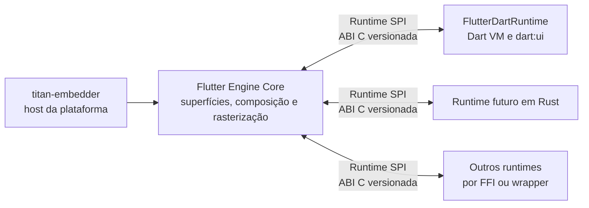

# Estudo: Flutter Engine com SPI de runtime neutro (Dart opcional)

**Data:** 2026-10-14
**Status:** desenho aprovado; implementação futura (meta 3 do `titan-flutter-engine`)
**Escopo:** o contrato entre o núcleo gráfico do engine e os runtimes de UI. A implementação de um framework Rust
fica para outro estudo.

## Contexto

O `titan-embedder` do TitanDM é escrito em Rust e integra o host ao Flutter Engine pela Embedder API C. Essa
fronteira cobre inicialização, superfícies, métricas, entrada, vsync, mensagens de plataforma e apresentação. Ela
**não** torna o runtime Dart opcional: o engine cria a Dart VM e o isolate raiz, e o framework Flutter conversa com o
C++ interno por `dart:ui`.

A meta é que o engine continue executando apps Flutter em Dart e, numa configuração de build alternativa, possa ser
compilado **sem construir, linkar ou empacotar o runtime Dart**. Um runtime futuro, começando por Rust, usaria uma
interface neutra para produzir cenas e semântica. A fronteira não é específica de Rust, .NET, Dart ou de um
framework.

## Objetivos

- Isolar as dependências de Dart num backend opcional.
- Preservar o fluxo e o comportamento dos apps Flutter em Dart quando esse backend está habilitado.
- Definir uma ABI C versionada para runtimes que não dependam de Dart.
- Permitir que outros runtimes usem o núcleo gráfico sem expor tipos privados do engine.
- Manter compositor, sessão, lock e demais processos do TitanDM fora do processo do runtime de UI.

## Fora de escopo

- Implementar agora um framework Flutter em Rust ou em outra linguagem.
- Prometer que pacotes ou código Dart executem em outros runtimes.
- Replicar widgets, layout, animações ou APIs do framework Flutter.
- Isolamento de processos para runtimes neste primeiro desenho.
- Definir todas as primitivas gráficas e serviços de plataforma da ABI em nível de código.

## Decisões

1. O Engine será dividido entre `libflutter_engine_core.so`, sem Dart e com
   o core gráfico, e `libflutter_engine.so`, o `flutterDartEngine` que mantém a
   Dart VM, `dart:ui`, snapshots e a Embedder API atual. A opção de build com
   Dart permanece padrão; o perfil sem Dart precisa remover essas dependências
   do grafo GN e dos artefatos.
2. O Runtime SPI terá uma ABI C versionada e uma API de cena com handles
   opacos e contagem de referência. A API cobrirá o nível de composição de
   `dart:ui` sem expor widgets Dart nem tipos C++ privados do Engine.
3. O runtime alternativo será o repositório `flutter-rs`, com port fiel da
   arquitetura do framework Flutter no commit fixado em `flutter.lock`. A
   paridade será conferida por testes portados, `scene_trace`, dumps canônicos
   de árvores e tolerância numérica `1e-10`.

Os primeiros seams C++ e a medição da S1 estão registrados em
[runtime-spi-baseline.md](medidas/runtime-spi-baseline.md) e no
[resultado do Checkpoint B](medidas/runtime-spi-s1.md).

## Arquitetura proposta

| Componente | Papel |
|---|---|
| **Flutter Engine Core** | Integração gráfica comum: superfícies, composição, rasterização e os serviços do SPI. Não depende de `DartVM`, `Dart_Isolate`, `Dart_Handle`, snapshots nem de APIs Dart. |
| **Runtime SPI** | Contrato interno e versionado entre o Core e um backend de runtime. ABI primária em C (sem depender da ABI C++ nem de recursos de uma linguagem): tabelas de funções, estruturas versionadas, *handles* opacos e capacidades negociáveis. |
| **FlutterDartRuntime** | Backend opcional com a Dart VM, os isolates, o `dart:ui` e a ponte entre o framework Flutter e o SPI. É o primeiro backend e mantém os apps Dart existentes; pode ser excluído do grafo de build. |
| **titan-embedder** | Continua sendo o host da plataforma. A Embedder API segue como fronteira para Wayland/KMS, métricas, entrada, vsync, mensagens e apresentação; o SPI não a substitui. |
| **Runtimes futuros** | Rust é a primeira linguagem prevista. O SPI não define o framework Rust nem exige as mesmas APIs de widgets. |

## Build e seleção do runtime

- A opção de build do Dart fica **habilitada por padrão** (comportamento atual).
- Uma opção explícita compila sem o backend Dart. Nesse perfil, o Core não compila, não linka nem distribui a Dart
  VM, o `dart:ui`, os snapshots ou o framework Dart; ele hospeda um runtime que implemente o SPI e não executa apps
  Flutter em Dart.
- A separação precisa existir no **grafo GN e nos artefatos publicados**, não só numa opção de execução que deixa a
  Dart VM linkada no binário.
- O mecanismo de seleção e carga (biblioteca dinâmica, ligação estática ou outro) fica para o protótipo.

No `titan-flutter-engine`, essa opção será uma pasta de patches própria (por exemplo `runtime-spi/`), condicionada
por um argumento de gn, como as demais pastas por assunto.

## Contrato e fluxo de dados

O SPI é bidirecional:

- **Engine → runtime:** ciclo de vida, métricas e remoção de views, eventos de teclado e ponteiro, vsync/deadline,
  mensagens de plataforma e estado de acessibilidade.
- **Runtime → engine:** pedido e submissão de quadros, cenas gráficas, atualizações de semântica, mensagens de
  plataforma, logs e erros.

O runtime constrói a cena com uma API gráfica neutra do engine, que cobre no mínimo composição de desenho,
transformações, recortes, opacidade, texto, imagens e referências a recursos. O engine converte essa representação
para as estruturas internas e continua responsável pela rasterização. Widgets, layout, gestos de alto nível, modelos
de estado e APIs de aplicação pertencem a cada framework: a ABI não expõe widgets Dart nem tipos C++ como `Scene` e
`LayerTree`.

O backend Dart mantém o `dart:ui` para os seus consumidores, mas a implementação interna passa a entregar quadros e
semântica pelo contrato neutro. Um backend Rust usa a mesma ABI por FFI; uma linguagem sem FFI C direto pode usar
*bindings* ou um *wrapper*.

## Versionamento e propriedade de recursos

- Versão maior sinaliza incompatibilidade; versão menor adiciona capacidades compatíveis.
- Estruturas carregam tamanho e versão, para evoluir sem depender do layout de uma linguagem.
- A inicialização negocia capacidades gráficas e de plataforma; o runtime só usa as que o engine anunciou.
- Buffers, cenas e recursos usam *handles* opacos com regras explícitas de retenção e liberação; nenhum ponteiro
  temporário é retido para uso assíncrono.
- Erros atravessam a ABI por códigos e resultados explícitos: panics do Rust e exceções C++/.NET não cruzam a
  fronteira.
- Chamadas do runtime levam identificadores de view e de sequência; quadros têm token e deadline, e submissões
  atrasadas ou de views removidas podem ser descartadas.

## S2: ABI C

A S2 fixa a primeira versão do contrato em
`engine/src/flutter/runtime_spi/include/flutter_runtime_spi.h`. O header é C11
puro, também pode ser incluído por C++, e não expõe tipos privados do engine.
As tabelas do runtime e do engine usam `struct_size`, versão maior e versão
menor; a versão maior incompatível impede o `start`, enquanto a versão menor
permite extensões compatíveis quando o tamanho e as capacidades anunciadas as
suportam. A versão publicada nesta fase é `0.1`.

O engine anuncia capacidades como tarefas, mensagens de plataforma, eventos de
ponteiro e teclado, semântica, foco de view e cena vazia. O runtime declara as
capacidades obrigatórias na sua tabela, e só inicia quando todas estão
disponíveis. Resultados como `kFlutterSpiIncompatibleVersion`,
`kFlutterSpiInvalidHandle`, `kFlutterSpiStaleFrame` e
`kFlutterSpiWrongThread` atravessam a fronteira como valores explícitos; a ABI
não lança exceções nem permite que panics atravessem o contrato.

Os ponteiros recebidos pelos callbacks são emprestados e só permanecem válidos
durante a chamada. Isso inclui métricas, eventos, mensagens, buffers, strings e
listas de locales; strings são UTF-8 terminadas em zero. Um runtime que precise
de um valor depois do retorno precisa copiá-lo. Cenas e respostas usam handles
opacos: a cena submetida é consumida em qualquer resultado de `submit_frame`,
`respond` consome o handle de resposta, e respostas pendentes são completadas
vazias quando o backend é encerrado.

As chamadas do runtime para o engine são feitas no UI runner. Uma chamada de
outra thread retorna `kFlutterSpiWrongThread`; `post_task`, `now_ns` e `log`
são as exceções previstas para uso fora dele. Cada quadro carrega token e
deadline, e um token atrasado ou uma view removida é rejeitado sem chegar ao
rasterizer. A S2 usa apenas `scene_create_empty`; a representação de cena
completa fica para a S3.

## S3a: API de cena

A S3a completa a representação mínima de cena do SPI sem expor tipos C++ do
engine. A tabela `FlutterSpiSceneApi` acrescenta operações para paths, paints,
recorders de pictures, canvas e scene builder. Pontos, retângulos, rrects,
matrizes e cores são valores C11; shaders, filtros, texto, imagens, texturas e
platform views permanecem para a S3b.

Os recursos são referenciados por handles opacos: `FlutterSpiPath`,
`FlutterSpiPictureRecorder`, `FlutterSpiPicture`, `FlutterSpiSceneBuilder` e
`FlutterSpiScene`. Cada engine mantém sua própria tabela de handles, com ids
crescentes que não são reutilizados. `retain` e `release` controlam as
referências; um handle liberado, forjado ou pertencente a outro engine retorna
`kFlutterSpiInvalidHandle` sem acessar a memória do recurso. O recorder é
consumido por `recorder_finish` ou descartado por `recorder_release`, e não
pode ser usado depois disso.

As funções de construção da cena executam no UI runner, como as operações
equivalentes de `dart:ui`; uma chamada em outra thread retorna
`kFlutterSpiWrongThread`. Ponteiros de entrada são emprestados e só precisam
ser válidos durante a chamada. Geometria não finita é rejeitada com
`kFlutterSpiInvalidArgument` antes de gravar a operação. `scene_pop` além da
raiz é ignorado, e `scene_build` fecha automaticamente as camadas ainda
abertas. Ao inserir uma picture na cena, o engine mantém a referência interna,
portanto a cena continua válida depois que o handle original é liberado.

O scene builder produz um `LayerTree` com transformações, offsets, clips,
opacity e pictures. `scene_trace` percorre essa árvore e as `DisplayList`
associadas, devolvendo UTF-8 determinístico com tamanho do frame, hierarquia
de camadas, valores geométricos e operações de desenho. O buffer retornado
deve ser liberado com `trace_free`. Esse traço é o oráculo textual da paridade
entre uma cena montada pela ABI e a mesma cena montada diretamente pelo
engine.

O checkpoint da S3a confirmou a mesma saída do probe Dart no x64 e no
arm64-musl, a configuração GN nos dez alvos previstos e o layout de 32 bits
do alvo `runtime_spi_c_api` em arm-hard. A medição de custo da ABI está em
[runtime-spi-s3a.md](medidas/runtime-spi-s3a.md).

## S3b-1: texto

A S3b-1 acrescenta texto ao Runtime SPI sem expor tipos C++ do engine. A
`FlutterSpiTextApi` cobre carregamento de fontes, estilos aninhados,
construção de parágrafos, layout, métricas, retângulos de seleção, posição de
glifo, limites de palavra, métricas de linha e desenho no recorder da S3a.
Estilos e parágrafos usam handles opacos por engine e o parágrafo é consumido
ao ser construído.

Os estilos preservam as propriedades de `txt`, incluindo decoração, peso,
estilo, baseline, altura, espaçamentos, famílias, sombras, features e
variações. Um `struct_size` menor mantém os padrões do `txt`, e ponteiros
nulos representam propriedades ausentes. `font_load` registra bytes de uma
fonte pela `FontCollection`, opcionalmente sob um alias; bytes inválidos são
rejeitados sem registrar uma família.

O texto de entrada é UTF-8 validado, enquanto offsets e índices expostos pelas
consultas são unidades UTF-16, como em `dart:ui`. `paragraph_layout` recebe a
largura e precisa preceder métricas e consultas. As listas seguem o padrão de
contagem primeiro: uma capacidade menor preenche o prefixo disponível,
retorna a contagem total e mantém o resultado `kFlutterSpiOk`.

As operações de texto executam no UI runner e chamadas de outras threads
retornam `kFlutterSpiWrongThread`. Um parágrafo sem layout retorna
`kFlutterSpiInvalidArgument`; texto UTF-8 inválido e fontes inválidas também
retornam resultados explícitos pela ABI. O desenho usa `txt::Paragraph::Paint`
no `DisplayListBuilder`, e a paridade compara o conteúdo das operações de
texto, não ponteiros internos de `SkTextBlob`.

Os testes carregam a `Roboto-Regular.ttf` do próprio checkout, inicializam o
ICU antes de montar parágrafos e comparam as métricas e consultas da ABI com
um `txt::Paragraph` direto. O checkpoint confirmou **78 testes** do Runtime
SPI, incluindo os testes de texto, além de repetição isolada e embaralhada.
Os detalhes e os resultados de build estão em
[runtime-spi-s3b1.md](medidas/runtime-spi-s3b1.md).

## S3b-2: imagens

A S3b-2 acrescenta imagens ao Runtime SPI sem colocar código Dart no core. A
`ImageDescriptorData` separa os dados de `ImageDescriptor` do wrapper de
`dart:ui`, e o alvo GN `ui_image_decoding` reúne o caminho de decodificação
sem dependências de Dart. O wrapper Dart continua delegando para os mesmos
dados, preservando o comportamento existente do caminho `dart:ui`.

A ABI 0.4 expõe `FlutterSpiImageApi`, com handles opacos sobre imagens do
engine, criação a partir de pixels crus, decodificação de bytes codificados,
consulta de tamanho, retenção, liberação e desenho de imagens, retângulos,
nine-patch e atlas. A validação rejeita formatos e buffers inconsistentes
com resultados explícitos pela ABI. As funções de cena executam no UI runner;
chamadas de outras threads retornam `kFlutterSpiWrongThread`.

Os callbacks de decodificação são sempre enfileirados para uma tarefa
posterior no UI runner, inclusive quando o decodificador encontra um erro.
Bytes sem um `ImageGenerator` compatível e buffers de pixels inválidos são
rejeitados sem callback. Se o backend parar enquanto uma decodificação estiver
pendente, o resultado é descartado, o callback do runtime não é chamado e a
imagem produzida é liberada.

Como o caminho sem Dart não recebe os workers da VM, a fábrica do SPI mantém um
`ConcurrentMessageLoop` próprio e fornece seu runner concorrente ao core. A
resolução do tamanho-alvo também reproduz a regra do `dart:ui`: dimensões
ausentes usam o tamanho original, e uma única dimensão preserva a proporção.
Os detalhes e os resultados de build estão em
[runtime-spi-s3b2.md](medidas/runtime-spi-s3b2.md).

## S3b-3: imagens de saída

A S3b-3 amplia o Runtime SPI para transformar pictures e cenas em imagens,
ler os pixels resultantes e decodificar codecs quadro a quadro, sem colocar
código Dart no core. O trabalho que era próprio dos wrappers de `dart:ui` foi
separado em três costuras Dart-free no alvo GN `ui_image_output`:
`image_snapshot` rasteriza pictures e cenas; `image_readback` converte imagens
para raster e codifica bytes; `animated_image_frames` mantém o estado e o
avanço dos quadros de um `ImageGenerator`.

A ABI 0.5 adiciona a capacidade `kFlutterSpiCapImageOutput` e funções para
`picture_to_image`, `scene_to_image`, suas variantes síncronas diferidas,
`image_to_bytes` e o ciclo de vida de `FlutterSpiCodec`. A API mantém as
regras de `dart:ui`: dimensões não positivas são rejeitadas, snapshots
assíncronos entregam o resultado no UI runner, bytes só são válidos durante o
callback e a cena continua utilizável depois de virar imagem. A variante
síncrona devolve uma imagem diferida, enquanto a variante assíncrona espera a
rasterização antes de chamar o runtime.

Codecs estáticos repetem o único quadro com duração zero. Codecs animados
usam o runner de IO, expõem a contagem de quadros e repetições, preservam as
durações do `ImageGenerator` e voltam ao primeiro quadro depois do último.
Liberar um codec enquanto há uma leitura pendente descarta o resultado e não
invoca o callback posteriormente. O caminho de saída mantém os mesmos
contratos de handles, callbacks e encerramento do backend das fases anteriores.

O checkpoint confirmou que o caminho Dart não mudou e que o probe manteve o
hash `9afdbcd18abd9b35` em x64 e arm64-musl. A série limpa contém 56 patches
do repositório do Flutter, dos quais 41 pertencem a `runtime-spi`.
`check-runtime-spi.sh` passou com e sem testes, totalizando **1142 PASS** e
**0 FAIL**; `runtime_spi_unittests` executou 122 testes, com um teste pulado
e o motivo registrado porque o fixture não injeta um `SnapshotDelegate` sem
superfície. A repetição embaralhada tripla, a configuração `--gn-only` dos
dez alvos, o layout arm-hard de `runtime_spi_c_api` e
`tools/ci.sh engine` também passaram.

Os números e a identificação do engine estão em
[runtime-spi-s3b3.md](medidas/runtime-spi-s3b3.md).

## S3b-4a: efeitos de pintura

A S3b-4a amplia o Runtime SPI para os efeitos de pintura que o `dart:ui`
aplica ao `Paint`: shaders de gradiente e de imagem, filtros de cor, filtros
de imagem, máscara de blur e vertices. A ABI 0.6 adiciona
`FlutterSpiPaintEffectsApi` e a capacidade `kFlutterSpiCapPaintEffects`; o
`FlutterSpiPaint` mantém compatibilidade estrutural porque os novos campos
ficam no fim da struct.

Shaders, filtros e vertices são handles opacos por engine sobre os objetos
`Dl*` correspondentes. As fábricas reproduzem as conversões e validações do
`dart:ui`, incluindo modos de tile, stops de gradiente, matrizes finitas,
sigmas não negativos e índices de vertices dentro do intervalo. O paint
resolve os handles no momento da gravação, e a picture retém os objetos
necessários: liberar um shader depois de pintar não altera a picture já
registrada. A comparação de paridade usa a igualdade por conteúdo dos
atributos `Dl*`, inclusive para o shader de imagem que compartilha o mesmo
`DlImage`.

As operações de cena continuam restritas ao UI runner e erros de handle,
argumento ou thread retornam resultados explícitos pela ABI. Um `Paint` criado
com o tamanho da S3a não possui efeitos, e o alvo sem Dart mantém apenas a
implementação nativa do engine. Vertices seguem o builder e as flags de
`Vertices::init`; `canvas_draw_vertices` registra a mesma operação que
`Canvas.drawVertices`.

O checkpoint confirmou o hash `9afdbcd18abd9b35` do probe em x64 e
arm64-musl, 1180 testes aprovados e nenhum teste falho no checker, além de
160 testes da suíte `runtime_spi_unittests` e um teste pulado. A série limpa
contém 62 patches do repositório do Flutter, dos quais 47 pertencem a
`runtime-spi`. A configuração `--gn-only` dos dez alvos, o layout arm-hard de
`runtime_spi_c_api` e `tools/ci.sh engine` também passaram.

Os números, o hash do engine e as correções do layout de 32 bits estão em
[runtime-spi-s3b4a.md](medidas/runtime-spi-s3b4a.md).

## S3b-4b: camadas do scene builder

A S3b-4b amplia o Runtime SPI para as camadas restantes do scene builder: color filter, image filter, backdrop, shader mask, clip de superelipse, textura, platform view e performance overlay. A ABI 0.7 acrescenta as funções novas no fim da `FlutterSpiSceneApi`, além de `image_filter_blur_bounded` no fim da `FlutterSpiPaintEffectsApi`, e a capacidade `kFlutterSpiCapSceneLayers`.

As camadas retidas usam o handle `FlutterSpiEngineLayer`. Em vez de mudar as `scene_push_*` congeladas da S3a, o runtime usa `scene_take_last_layer` para obter a camada no topo da pilha, `scene_assign_old_layer` para preservar o `original_layer_id`, como o `oldLayer` do `dart:ui`, e `scene_add_retained` para inserir o mesmo objeto `Layer` no quadro seguinte. O handle sobrevive ao builder, e a regra de uso único por cena de `compositing.dart` (`_debugCheckUsedOnce`) é aplicada sempre, não só em debug.

O blur dinâmico usa `tile_mode = -1`, como o `tile_mode_index < 0` do `ImageFilter::initBlur`; quem usa o filtro escolhe o modo: imagens, atlas e `drawPaint` resolvem `kClamp`, as demais operações de canvas resolvem `kDecal`, a camada de image filter resolve `kDecal` e o backdrop resolve `kMirror`, como o `canvas.cc` e o `scene_builder.cc`. Esse suporte, junto com os `bounds`, faltava na S3b-4a.

O checkpoint confirmou 1204 PASS e 0 FAIL no `check-runtime-spi.sh`, o probe `9afdbcd18abd9b35` em x64 e arm64-musl sob QEMU, a configuração `--gn-only` dos dez alvos, o alvo `runtime_spi_c_api` em arm-hard e `tools/ci.sh engine`. A série limpa contém 68 patches do repositório do Flutter, dos quais 53 pertencem a `runtime-spi`. Os números e a identificação do engine estão em [runtime-spi-s3b4b.md](medidas/runtime-spi-s3b4b.md).

## S3b-4c: fragment programs

A S3b-4c separa o carregamento de runtime effects na costura `runtime_effect_loader`: ela decodifica os runtime stages, escolhe o backend, registra o `library_id`, consulta o cache do raster quando necessário e monta o `DlRuntimeEffect`. Essa costura existe para que o Runtime SPI reutilize o miolo de `FragmentProgram::initFromAsset` sem depender de Dart, enquanto o `dart:ui` continua responsável apenas pelo mapa de uniforms.

A ABI 0.8 expõe programs imutáveis e shaders que guardam floats e samplers. Como no `ReusableFragmentShader`, os uniforms são copiados quando o shader vira `FlutterSpiShader` ou `FlutterSpiImageFilter`, portanto alterações posteriores não afetam o objeto já criado. Erros atravessam a ABI por `FlutterSpiResult`; `out_error`, quando fornecido, recebe as mesmas mensagens do `dart:ui` e é liberado por `trace_free`.

O backend do runtime stage usado pelo SPI vem da fábrica, que já o recebe para construir o backend, e o carregamento de assets usa o `AssetManager` fornecido pelo `RuntimeDelegate`. Assim, programas podem ser carregados de assets ou de bytes mantendo a seleção do backend e as regras de uniforms e samplers do caminho Dart.

O checkpoint confirmou 1221 PASS e 0 FAIL no `check-runtime-spi.sh`, o probe `9afdbcd18abd9b35` em x64 e arm64-musl sob QEMU, a configuração `--gn-only` dos dez alvos, o alvo `runtime_spi_c_api` em arm-hard e `tools/ci.sh engine`. A série limpa contém 72 patches do repositório do Flutter, dos quais 57 pertencem a `runtime-spi`; o `engine.lock` registra `patches_sha256=94269ed8c3d24e9e52bb09ca1ded81a2c166307f57e4f4058a874cd8bbb7fc78`. Os números e a identificação do engine estão em [runtime-spi-s3b4c.md](medidas/runtime-spi-s3b4c.md).

## S3b-5: semântica

A S3b-5 acrescenta a ABI 0.9 para publicar a árvore de semântica de uma view sem Dart. Um builder opaco recebe nós e ações customizadas por structs com `struct_size`, e `update_submit` consome o builder e entrega a atualização ao engine. A capacidade `kFlutterSpiCapSemanticsUpdate` anuncia esse sentido da API; ela é distinta de `kFlutterSpiCapSemantics`, da S2, que liga a semântica e as ações vindas da plataforma.

A conversão copia campo a campo o que `SemanticsUpdateBuilder::updateNode` e `updateCustomAction` constroem: flags e tristates, ações, textos com atributos, geometria, transformações, filhos, papéis, validação e ações customizadas. O comparador dos testes monta o `SemanticsNode` e a `CustomAccessibilityAction` diretamente na mesma sequência e confere todos os campos, inclusive o tipo e o locale dos atributos de string.

O SPI rejeita com `kFlutterSpiInvalidArgument` entradas que o `dart:ui` derrubaria com `FML_CHECK`, como `scroll_children` sem `children_in_hit_test_order`; `NULL` representa a string vazia e todo texto UTF-8 é validado. Essas diferenças são deliberadas para manter uma ABI C sem exceções e devolver erros explícitos ao chamador.

O checkpoint confirmou 1236 PASS e 0 FAIL no `check-runtime-spi.sh`, o probe `9afdbcd18abd9b35` em x64 e arm64-musl sob QEMU, a configuração `--gn-only` dos dez alvos, o alvo `runtime_spi_c_api` em arm-hard e `tools/ci.sh engine`. A série limpa contém 75 patches do repositório do Flutter, dos quais 60 pertencem a `runtime-spi`; o `engine.lock` registra `patches_sha256=6d0d5a87f04b484c75a377ba1f01794109e1d2c7ba02d0e96e4894002b9a4dfb`. Os números e a identificação do engine estão em [runtime-spi-s3b5.md](medidas/runtime-spi-s3b5.md). Com ela, a S3 está completa; a próxima fase é a S4, com `dart:ui` sobre o SPI.

## S4a: extensões do runtime

Na S4a, o Engine passa as funções que só existem com Dart por uma tabela C opcional de extensões do Runtime SPI (ABI 0.10). A decisão evita uma ponte C++ entre as bibliotecas `.so`, que manteria uma fronteira dependente de tipos e convenções privadas do C++, e evita mover essas funções para fora do core, onde elas ainda são necessárias para o caminho Dart e devem permanecer na fronteira explícita entre o Engine e o runtime.

O `DartRuntimeBackend` preenche uma tabela estática de *thunks* para seus membros, enquanto o `SpiRuntimeBackend` obtém a tabela entregue pelo runtime C. O campo `extensions` fica no fim de `FlutterSpiRuntimeTable` e pode ser nulo para runtimes sem extensões ou tabelas antigas. Strings retornadas pelo runtime são liberadas por `free_string` da própria tabela, e os mapeamentos de bibliotecas deferred carregam a função de liberação do runtime, que mantém a propriedade enquanto as instruções estiverem em uso.

O checkpoint confirmou **1242 PASS** e **0 FAIL** no `check-runtime-spi.sh`, contra 1236 PASS na S3b-5, além do hash `9afdbcd18abd9b35` do probe em x64 e arm64-musl sob QEMU, a configuração `--gn-only` dos dez alvos, o alvo `runtime_spi_c_api` em arm-hard e `tools/ci.sh engine`. A série limpa contém **78 patches** do repositório do Flutter, dos quais **63** pertencem a `runtime-spi`; o `engine.lock` registra `patches_sha256=644a727099bb6ab1018ae5d2de2cad44b9ae255a1a7f73fa036e57dd681bec1b`. Os benchmarks e seus critérios estão em [runtime-spi-s4a.md](medidas/runtime-spi-s4a.md).

## S4b: Shell sem Dart

A S4b separa os handlers do service protocol do transporte: o core expõe um `FlutterSpiServiceHandler` estável, e o runtime registra esse handler no VM service pela tabela de extensões ABI 0.11. A resolução do método, a troca para o runner correto e a espera pela resposta continuam no core, porque o `fml::TaskRunner` não atravessa a fronteira C; o transporte apenas adapta a chamada para o VM service. Assim, um runtime sem transporte não impede o Shell de subir, e o handler pode rejeitar chamadas depois da destruição do Shell sem acessar um objeto inválido.

Os pontos que ainda dependiam de Dart no `shell.cc` foram para `shell_dart.cc`: a inferência dos dados de inicialização da VM, as sobrecargas de `Shell::Create` que criam a VM e o `tonic::SetLogHandler`. O `Spawn` fica para a S4c, enquanto a retirada definitiva do embrulho Dart para uma biblioteca separada fica para a S5.

O checkpoint confirmou **1250 PASS** e **0 FAIL** no `check-runtime-spi.sh`, o probe `9afdbcd18abd9b35` em x64 e arm64-musl sob QEMU, a configuração `--gn-only` dos dez alvos, o alvo `runtime_spi_c_api` em arm-hard e `tools/ci.sh engine`. A série limpa contém **82 patches** do repositório do Flutter, dos quais **67** pertencem a `runtime-spi`; o `engine.lock` registra `patches_sha256=4d4caa68c747fa9e2c341454c7f97cef15ebfe8ab941e9322fa4fbeccabeca57`. Os benchmarks estão em [runtime-spi-s4b.md](medidas/runtime-spi-s4b.md); `BM_ShellInitialization` ficou inconclusivo, e o A/B controlado entre as duas revisões compiladas permanece pendente para a S5.5.

## S4c-1: contrato completo

A S4c-1 completa a ABI 0.12 nos dois sentidos. Do engine para o runtime, o contrato passa a publicar telas, tempos de quadro e consultas de hit test; do runtime para o engine, passa a cobrir rota inicial, locale, semântica, ciclo de vida do isolate, deferred libraries, mensagens de canal, escala de fonte, foco, reset interno e leitura de assets. Esses pontos faltavam porque a tabela anterior cobria apenas as extensões opcionais já identificadas na S4a e os handlers de service protocol da S4b, deixando o restante do `RuntimeDelegate` e as solicitações correspondentes do `Engine` presos às interfaces internas em C++.

As strings e listas devolvidas pelo engine são alocadas e liberadas pela própria `FlutterSpiEngineApi`, enquanto mapeamentos de assets conservam a função `release` do `fml::Mapping` que os criou; assim, a propriedade não atravessa os módulos `.so` por um alocador inadequado. O `PlatformMessageHandler` permanece sem um campo próprio na ABI porque o envio de mensagens já o usa internamente e expor esse detalhe duplicaria uma otimização do engine, não um contrato necessário ao runtime.

O checkpoint confirmou **1275 PASS** e **0 FAIL** no `check-runtime-spi.sh`, contra 1250 PASS na S4b, além do probe `9afdbcd18abd9b35` em x64 e arm64-musl sob QEMU, da configuração `--gn-only` dos dez alvos, do alvo `runtime_spi_c_api` em arm-hard e de `tools/ci.sh engine`. A série limpa contém **85 patches** do repositório do Flutter, dos quais **70** pertencem a `runtime-spi`; o `engine.lock` registra `patches_sha256=a02204f0857fc6a46f7e1dc1315f48368bbd88b4c2b157295710bbec820512de`. Os benchmarks não foram medidos nesta fase, que não altera o pipeline de quadros; os números completos estão em [runtime-spi-s4c1.md](medidas/runtime-spi-s4c1.md).

## S4c-2: Dart como runtime de tabela

A S4c-2 transforma o Dart em um runtime de tabela: o `FlutterDartRuntime` passa a ser dono do `RuntimeController` e publica a `FlutterSpiRuntimeTable` inteira, enquanto a `DartRuntimeDelegateBridge` implementa a ponte do `RuntimeDelegate` e encaminha cada pedido para a `FlutterSpiEngineApi`. A fábrica passa a devolver um `SpiRuntimeBackend` sobre essa tabela, removendo o `DartRuntimeBackend` sem alterar o comportamento do caminho Dart.

As funções que ainda precisam de objetos C++ do engine passam por pontes internas do `runtime_spi`: `LayerTree`, `SemanticsNodeUpdates`, `FontCollection` e `AssetManager`. Elas não fazem parte do header público e são temporárias; desaparecem à medida que as áreas correspondentes de `dart:ui` passam a usar o SPI nas fases S4d–S4h.

O warm-up frame usa `frame_token == 0` fora de um `begin_frame`, quando não há quadro em andamento, e a conclusão correspondente vira `frames_done`; durante um quadro ativo, o token 0 continua obsoleto e é recusado. O lançamento do isolate cruza como ponteiro opaco pela extensão nova, e a ABI 0.14 acrescenta o resultado de adicionar/remover view, o estado "rodando" do runtime e métricas completas de view, incluindo restrições, insets de gesto e display features.

O checkpoint confirmou **1298 PASS** e **0 FAIL** no `check-runtime-spi.sh`, além do probe `9afdbcd18abd9b35` em x64 e arm64-musl sob QEMU, da configuração `--gn-only` dos dez alvos, do alvo `runtime_spi_c_api` em arm-hard e de `tools/ci.sh engine`. A série limpa contém **91 patches** do repositório do Flutter, dos quais **76** pertencem a `runtime-spi`; o `engine.lock` registra `patches_sha256=1e5f99699a9a3b4efaf91a9b209ff1097d270bc9d9681661c6f29809d9def115`. Os benchmarks de `shell_benchmarks` e `ui_benchmarks` permanecem pendentes e serão executados em rodada isolada depois da preparação dos sysroots, para não contaminar a medição com os seis núcleos ocupados pelo checkpoint.

## S4d-1: Canvas sobre a API de cena

A S4d-1 faz `Canvas`, `PictureRecorder` e `Picture` do `dart:ui` gravarem pela
API de cena do Runtime SPI. O `Canvas` continua sendo uma API por chamada no
core: cada operação chega à função correspondente da tabela do SPI, e o
`PictureRecorder` entrega o `FlutterSpiPictureRecorder` ao caminho de pintura.
Assim, a implementação Dart preserva a validação e as conversões existentes,
enquanto o core mantém a gravação e a composição pela cena.

A ABI 0.15 acrescenta desenho e recorte de superelipse, a matriz de
transformação e os limites de clip local e de destino. Shaders, filtros, paths,
imagens e vertices que ainda não têm uma migração completa entram por pontes
internas temporárias. Cada objeto guarda seu handle SPI em cache e o libera no
destrutor; a mutação de `CanvasPath` invalida o handle para que o próximo
desenho reflita a nova forma.

O portão usou um benchmark de quadro realista, com dez repetições e A/B
intercalado quando o kernel do fixture permitia a comparação. A base ficou em
524–527 µs; o caminho da Task 4 ficou em 642 µs, o ajuste de handles em 631 µs,
o cache de paint em 622 µs (+18%) e os argumentos escalares do t11 em
476–497 µs, com mediana de 487 µs (-7,6%). A tabela completa, a ressalva sobre
os kernels dos fixtures e o perfil callgrind estão em
[runtime-spi-s4d1.md](medidas/runtime-spi-s4d1.md).

A Task 10, que tentou natives leaf para passar os bytes do paint por ponteiro,
foi abandonada: a VM não executou as chamadas leaf, sem resolução de símbolo
nem exceção, e o trabalho foi preservado na branch
`wip/s4d1-task10-leaf`. A alternativa adotada na Task 11 passa os dados do
paint como argumentos escalares sem leaf. O `flutter-rs` continua sendo o
lugar previsto para um buffer de comandos quando uma linguagem com FFI caro
precisar agrupar chamadas; o core não ganha um formato binário novo.

O checkpoint desta série confirmou 1320 PASS e 0 FAIL no
`check-runtime-spi.sh`. A comparação de desempenho deve ser lida junto com a
nota de método da medição: cada binário precisa usar o kernel correspondente
ao seu fixture, e a base usada para a comparação do t11 veio de duas sessões
anteriores sem carga.

## S4d-2: Path sobre a API de cena

A S4d-2 faz `Path` e `PathMeasure` do `dart:ui` usarem a API de cena do
Runtime SPI. O `SpiPath` mantém um `SkPathBuilder` para mutações lineares e
publica snapshots para consultas, operações derivadas, desenho e medidas. O
`SpiPathMeasure` mantém a mesma iteração de contornos do
`SkContourMeasureIter`; os wrappers Dart continuam donos dos handles e a ponte
temporária para `DlPath` permanece somente onde o compositing ainda precisa
dela.

A ABI 0.16 acrescenta os métodos relativos, arcos, formas, composição,
consultas, cópia, transformação, deslocamento, operações booleanas e
`PathMeasure`. A mutação invalida os caches de snapshot e de `DlPath`, e uma
operação de path que falha não deixa handle de resultado. A paridade é coberta
contra os mesmos roteiros diretos em Skia, incluindo `addPath` com `extend`,
volatilidade, bounds, `contains` e a iteração de contornos.

O portão de desempenho foi medido com `BM_DartPathBuildFrame` e
`BM_DartCanvasRecordFrame`. A primeira medição encontrou uma regressão de 46%
na construção de paths; o perfil identificou a cópia de `SkPathBuilder` em
cada mutação. Depois da Task 5b, o builder passou a ser mantido no `SpiPath` e
o portão ficou em −0,6% nos dois benchmarks. As duas medições completas estão
em [runtime-spi-s4d2.md](medidas/runtime-spi-s4d2.md).

## S4e: Compositing sobre a API de cena

A S4e faz `SceneBuilder`, `EngineLayer` e `Scene` do `dart:ui` usarem a API
de cena do Runtime SPI. O `SceneBuilder.build()` não conhece as dimensões da
view, enquanto `scene_build` precisa de largura e altura e
`submit_frame` consome a cena. O builder passa a produzir uma raiz retida;
cada renderização ou snapshot cria uma cena nova, dimensionada para o uso, a
partir dessa raiz compartilhada.

A ABI 0.17 acrescenta `scene_build_root`, `scene_create_from_root` e
`scene_retain_last_layer`. A raiz é um handle ref-counted que sobrevive ao
builder e pode ser reutilizado em mais de uma view ou em quadros sucessivos.
Assim, o caminho `RuntimeController::Render` cria uma cena com as métricas da
view e chama `RenderScene`; a `DartRuntimeDelegateBridge` entrega essa cena
diretamente a `submit_frame`, que continua responsável por consumi-la. Filtros
nulos preservam a camada de passagem que o caminho original do `dart:ui`
produzia.

O armazenamento de `flow::Layer` no `Scene`, a pilha de layers do
`SceneBuilder` e a ponte `SpiSceneFromLayerTree` saem do caminho de
composição. Para `toImage` e `toImageSync`, a ponte temporária
`SpiSceneTakeLayerTree` e `Picture::RasterizeLayerTreeToImage` permanecem até
a S4g, quando os snapshots passarão para `scene_to_image`; as pontes internas
de filtros, shaders e pictures também continuam até as migrações dessas áreas.

O portão de desempenho foi aprovado em +2,0% no benchmark de construção de
cenas. As três medições, as causas da regressão inicial e as otimizações de
handles, retenção e matrizes estão em
[runtime-spi-s4e.md](medidas/runtime-spi-s4e.md).

## S4f: Texto sobre a API de texto

A S4f faz `ParagraphBuilder`, `Paragraph` e `FontCollection::LoadFontFromList`
do `dart:ui` usarem a API de texto do Runtime SPI. O core passa a ser o dono
dos builders e parágrafos por handles, enquanto o `lib/ui` conserva as mesmas
validações, conversões de resultados e regras de descarte do caminho anterior.
O carregamento dinâmico de fontes chega ao engine pela tabela do SPI e mantém
a disponibilidade da fonte para os builders seguintes da mesma engine.

A ABI 0.18 acrescenta as máscaras de estilo com as mesmas posições de bit do
`dart:ui`. `kFlutterSpiStyleFieldsMasked` liga explicitamente a interpretação
das máscaras; sem esse bit, inclusive em structs antigos ou zerados, todos os
campos continuam definidos como na ABI 0.17. Assim, `pushStyle` parte do
estilo atual e aplica somente os campos marcados, e a criação do parágrafo
porta para o core a herança de estilo, o `decodeStrut`, a distribuição de
leading e os overrides de altura do `ParagraphBuilder` original.

A mesma versão acrescenta as seis consultas que faltavam ao contrato:
informação de glifo, glifo mais próximo, limite da linha, métricas de uma
linha, contagem de linhas e número da linha. O texto e a reticência também
podem atravessar a fronteira em UTF-16 (`add_text_utf16` e `ellipsis_utf16`),
evitando a conversão UTF-16 → UTF-8 → UTF-16 no caminho quente.

A reticência passou a usar `ellipsis_utf16` diretamente quando o estilo Dart a
fornece, eliminando a conversão temporária por UTF-8. O core também preserva
o domínio de entrada do `txt`: layout com largura infinita, consultas antes
do layout, intervalos invertidos e valores de glifo ou placeholder que o
`txt` aceita chegam ao mesmo caminho, em vez de serem rejeitados pelo SPI.
Essa paridade corrigiu o abort observado no primeiro layout dos apps com
framework durante `tools/ci.sh engine`.

Para carregar fontes, o cliente da `PlatformConfiguration` e o
`RuntimeDelegate` passam a expor `GetSpiEngine()` no lugar de
`GetFontCollection()`. A ponte `SpiEngineFontCollection` sai do caminho do
`lib/ui`; `SpiPictureRecorderBuilder` também deixa de ser usada por
`Paragraph::paint`, que desenha pelo recorder do SPI. As pontes temporárias de
camadas e imagens que pertencem às fases posteriores permanecem fora desta
migração.

As tabelas internas de handles do SPI são alocadas intencionalmente e ficam
vivas até o fim do processo. Assim, wrappers liberados durante a destruição
estática não tentam acessar uma tabela que já foi destruída; a regra de
propriedade dos handles e a ABI permanecem inalteradas.

O benchmark composto da Task 1c combina, no mesmo quadro, construção de
cenas retidas, operações de `Canvas`/`Path`/`Paint` e parágrafos curtos e
longos. Ele representa melhor o custo integrado das migrações do que o
benchmark de texto isolado.

O benchmark de texto isolado ficou entre +4,9% e +5,9% no A/B de dez rodadas,
enquanto o quadro composto ficou em +5,5%. O usuário decidiu aceitar e
integrar o resultado composto; o custo restante, cerca de 130 ns por chamada
do SPI e aproximadamente nove chamadas para um parágrafo curto, fica para a
S5.5, que poderá reduzir o número de chamadas por span. As medições, as
causas das rodadas e as lições do método estão em
[runtime-spi-s4f.md](medidas/runtime-spi-s4f.md).

## S4g-1: Efeitos criados pelo SPI

A S4g-1 faz `Gradient`, `ColorFilter`, `ImageFilter` e `Vertices` do `dart:ui`
serem criados diretamente pela `FlutterSpiPaintEffectsApi`. Cada wrapper Dart
passa a guardar somente o handle do SPI, liberando-o no destrutor e no
`dispose`; `scene_builder.cc` e `canvas.cc` também consomem esses handles sem
recriar pontes a partir de objetos `Dl*`. A ABI 0.19 acrescenta a igualdade de
`ImageFilter`, preservando o resultado do `ImageFilter::equals` nativo,
inclusive para filtros nulos.

As fábricas do SPI mantêm o mesmo domínio de entrada das fábricas `Dl*`.
Assim, um filtro sem efeito é representado por `NULL` com resultado de sucesso,
os modos dinâmicos de blur continuam sendo resolvidos no consumidor e
`compose` preserva a semântica dos filhos sem efeito. Gradientes mantêm a
conversão de cores, stops opcionais e matriz 4×4 do caminho anterior; vertices
mantêm as validações de tamanhos e índices.

As pontes de conversão para color filter e vertices foram removidas
(`SpiColorFilterFromDl` e `SpiVerticesFromDl`), e os caminhos comuns de
`ImageFilter` e gradiente deixaram de usar `SpiImageFilterFromDl` e
`SpiShaderFromColorSource`. Permanecem duas pontes para a S4g-2:
`SpiShaderFromColorSource` ainda atende a criação de `ImageShader` e
`FragmentShader`, e `SpiImageFilterFromDl` ainda converte o `ImageFilter`
criado a partir de um fragment shader. A ponte `SpiPaintEffectsApi` apenas
expõe a tabela de fábricas ao `lib/ui`; ela não reintroduz a criação dos quatro
tipos por `Dl*`.

O portão de efeitos ficou em +1,8% no `BM_DartEffectsFrame`, abaixo do limite
de 5%. As comparações com o branch `develop` e os quatro benchmarks isolados
estão em [runtime-spi-s4g1.md](medidas/runtime-spi-s4g1.md).

## S4g-2: Imagens sobre o SPI

A S4g-2 faz `Image`, `Picture.toImage`, `Scene.toImage`, `ImageShader` e o
desenho de imagens do `dart:ui` usarem handles da `FlutterSpiImageApi`. O
`CanvasImage` passa a ser dono de um `FlutterSpiImage*`, consultando tamanho e
espaço de cor pela API e liberando o handle no destrutor e no `dispose`. O
`toByteData` usa `image_to_bytes`, e `Picture.toImage`/`toImageSync` e
`Scene.toImage`/`toImageSync` usam as operações de snapshot do SPI.

A ABI 0.20 acrescenta, no fim da tabela de imagens, a criação síncrona a partir
de pixels (`image_create_from_pixels_sync`), a consulta de espaço de cor
(`image_get_color_space`) e o snapshot síncrono com formato explícito
(`picture_to_image_sync_with_format`). Os enums do Dart e do SPI são mapeados
por nome. As callbacks de bytes continuam sendo entregues na thread de UI,
inclusive quando a leitura precisa rasterizar uma imagem de GPU ou diferida.

O caminho de `image_to_bytes` foi completado com a lógica de
`image_encoding.cc`, `image_encoding_skia.cc` e `image_encoding_impeller.cc`:
imagens raster, de GPU e diferidas usam a mesma conversão para raster, os
mesmos formatos de bytes e a mesma codificação PNG do caminho anterior. O
comportamento de retenção também permanece: um `ImageShader` ou um `Picture`
gravado mantém o handle vivo depois de um `Image.dispose()`.

Duas correções da fase foram registradas durante a implementação. Primeiro, o
readback do SPI passou a rasterizar imagens de GPU e diferidas, em vez de
falhar quando `asSkiaImage()` não produzia uma imagem raster. Segundo, o teste
de criação síncrona de pixels deixou de comparar bytes no fixture Skia: a
imagem diferida desse caminho só existe no backend Impeller. O teste compara o
tamanho, verifica que a imagem pode ser desenhada e só compara bytes quando o
backend do teste é Impeller, com `GTEST_SKIP()` explícito nos demais casos.

O fixture do benchmark também foi corrigido: `decodeImageFromPixelsSync` só
está disponível com Impeller, enquanto o Shell do benchmark roda com Skia. As
imagens passaram a ser produzidas por `Picture.toImageSync`, preservando o
caminho síncrono medido e permitindo o A/B nos dois binários.

O portão ficou em +0,1% no `BM_DartImageFrame`, dentro do limite de 5%. A
tabela completa e os indicadores contra `develop` estão em
[runtime-spi-s4g2.md](medidas/runtime-spi-s4g2.md). A medição estrutural do
SPI permanece reservada para a S5.5, como decidido no portão.

Ainda permanecem pontes para a S4g-3. Os produtores de imagens dos codecs
(`Codec`, `MultiFrameCodec` e `SingleFrameCodec`), `ImageDescriptor`,
`ImmutableBuffer`, o acesso a assets e os caminhos de `FragmentProgram`/
`ReusableFragmentShader` continuam entregando `DlImage` ao `CanvasImage` por
`SpiImageFromDlImage`. `SpiShaderFromColorSource` continua no
`FragmentShader`, e `SpiImageFilterFromDl` continua no filtro criado a partir
de fragment shader. Essas pontes são temporárias e não fazem parte dos
caminhos de `Image`, snapshots e `ImageShader` migrados nesta fase.

## S4g-3: Codecs, buffers e fragment shaders sobre o SPI

A S4g-3 faz `ImageDescriptor`, `Codec`, `ImmutableBuffer.fromAsset`,
`FragmentProgram`, `ReusableFragmentShader` e `ImageFilter.shader` do `dart:ui`
usarem diretamente as APIs do Runtime SPI. Descriptors codificados são
criados de forma síncrona, descriptors crus preservam a cópia do buffer, e
`instantiateCodec` recebe as opções de decodificação pela ABI. A leitura de
assets passa por `asset_read`; o lookup e a cópia ocorrem no worker concorrente
quando ele está disponível, e a callback continua sendo entregue na thread de
UI.

A ABI 0.21 acrescenta descriptors de imagem codificados e crus, leitura de
assets e validação dos recursos de fragment shaders. A criação de codec recebe
`FlutterSpiImageDecodeOptions`, cujo `target_pixel_format` fica no fim da
struct para preservar a compatibilidade com leitores de versões anteriores.
Os valores de formato de pixel mantêm a ordem do `TargetPixelFormat` do Dart.
Também fazem parte do contrato as validações de samplers e do filtro de
imagem do shader, com os mesmos textos de erro do caminho anterior.

Saem do caminho migrado as pontes `SpiImageFromDlImage`,
`SpiShaderFromColorSource`, `SpiImageFilterFromDl` e o caminho de
`Picture::display_list_`. A ponte `SpiEngineAssetManager` permanece: o
`flutter_gpu` e a configuração do isolate ainda precisam de um
`AssetManager` C++, enquanto o `dart:ui` lê bytes por `asset_read`.

### Contratos corrigidos

A migração também tornou explícitos quatro contratos que precisavam ser
preservados:

- `codec_release` não cancela quadros já pedidos. Cada callback pendente é
  entregue exatamente uma vez, enquanto pedidos novos depois do release são
  rejeitados.
- O codec usa o gerador do descriptor e o registry do engine. Assim, os
  decoders registrados por `Shell::RegisterImageDecoder` continuam válidos.
- `asset_read` lê no worker concorrente e entrega o resultado na UI. Os três
  pontos que constroem `SpiRuntimeBackend` recebem o worker correspondente;
  sem worker, a leitura mantém o fallback na UI.
- `ImageDescriptor.raw` aceita buffer menor que `rowBytes × height`. A criação
  do descriptor permanece segura, e a falha aparece na decodificação, como no
  comportamento anterior.

## S4h-1: Semântica sobre o SPI

A semântica do `dart:ui` passa pelo Runtime SPI. `SemanticsUpdateBuilder` e
`SemanticsUpdate` guardam um `FlutterSpiSemanticsUpdateBuilder*`, e
`updateSemantics` entrega o update por `semantics->update_submit`.
`RuntimeDelegate::UpdateSemantics` recebe o handle, como ocorre com o
`RenderScene` da S4e, e o `Engine` move os mapas para o `Shell`. A ponte
`SpiSubmitSemantics` saiu do caminho.

A ABI continua na versão 0.21: somente o comentário de contrato em
`flutter_semantics.h` muda.

### Contratos

- O release vale em qualquer thread e depois de o backend morrer. Builders
  órfãos continuam sendo liberados porque, com `Spawn`, o isolate group
  sobrevive ao engine.
- A segunda entrega do mesmo `SemanticsUpdate` é recusada; antes, ela enviava
  mapas vazios.
- As strings são cortadas no primeiro NUL.
- O validador UTF-8 de `runtime_spi/internal/spi_utf8.*` mantém paridade com o
  ICU e também é usado pelo texto.

## S4h-2: Platform messages de isolates de fundo sobre o SPI

O levantamento mostrou que todos os natives de `PlatformConfigurationNativeApi`
já passavam pelo SPI desde a S4c-2. A ponte que restava era
`SpiEnginePlatformMessageHandler`, que entregava ao lado Dart um
`weak_ptr<PlatformMessageHandler>` do `Shell` para os isolates de fundo.

A ABI 0.22 substitui essa ponte por um `FlutterSpiPlatformMessageSender` opaco.
`platform_message_sender_create` só pode ser chamado na thread de UI;
`platform_message_sender_send` e `platform_message_sender_release` podem ser
chamados em qualquer thread. A capacidade
`kFlutterSpiCapBackgroundPlatformMessages` anuncia o suporte. A resposta é
entregue na thread de quem responde e exatamente uma vez. Depois que o engine
ou o handler da plataforma desaparece, as operações retornam
`kFlutterSpiInvalidHandle`.

No lado Dart, `PlatformMessageSender` em
`lib/ui/window/platform_message_sender.*` usa o sender guardado por token em
`DartIsolateGroupData`. O `RuntimeDelegate::CreatePlatformMessageSender`
entrega esse recurso ao runtime.

### Defeitos encontrados

1. Um envio que falha não completa a resposta, como antes. A primeira versão
   completava a resposta e enviava `[id, null]` à porta; isso não preservava o
   contrato legado de lançar a exceção no Dart.
2. Havia um defeito anterior ao SPI: o helper `HandlePlatformMessage` de
   `platform_configuration.cc` criava a string de erro enquanto o payload ainda
   estava adquirido por `Dart_TypedDataAcquireData`. A VM recusava esse acesso e
   o isolate de fundo morria em vez de receber a exceção. Agora o payload é
   copiado e liberado antes do despacho.

Não há portão de desempenho nesta etapa: o caminho de quadro não muda.

## S4i-1: Um acessor da ABI no dart:ui

O `lib/ui` passa a ler todas as tabelas do Runtime SPI por `SpiApi()`, em
`lib/ui/spi_api.{h,cc}`. O `FlutterDartRuntime::Start` instala uma cópia da
`FlutterSpiEngineApi` uma única vez. A cópia é necessária porque a struct de
cada engine morre com o backend; as sub-tabelas do core são estáticas.

Saem do `lib/ui` `SpiSceneApi()`, `SpiPaintEffectsApi()`, `SpiImageApi()`,
`SpiFragmentApi()`, `TextApi()`/`SpiEngineTextApi`, `SpiEngineSemanticsApi`,
`SpiEngineAssetRead`, `SpiEngineFreeString` e `SpiEngineFontLoad`. Essas nove
pontes também saem do `spi_internal_bridges`.

Como efeito colateral, os acessores antigos montavam e copiavam a struct
inteira, de 320 bytes, a cada chamada.

Para a S4i-2 ficam o `SpiPathDlPath` em `path.cc`/`path_measure.cc`, os
includes `Dl*`/`flow`/`impeller`/`shell` restantes, o corte dos deps GN do
`lib/ui:ui` e o `assert_no_deps`. A medição do portão está em
[runtime-spi-s4i1.md](medidas/runtime-spi-s4i1.md).

## S4i-2: Código morto e pontes C++ do dart:ui

Depois do acessor único da S4i-1, a ABI 0.23 acrescenta `path_set_volatile` ao
fim da `FlutterSpiSceneApi`. O `dart:ui` passa a usar esse ponto de entrada
público para a volatilidade dos paths.

O código morto que restava da migração para o SPI foi removido: `SingleFrameCodec`,
`MultiFrameCodec`, `Paint::paint`, `Shader::shader()` e seus overrides,
`CanvasPath::path()`, `Picture::RasterizeToImageSync`,
`Picture::RasterizeToImage`, `Picture::RasterizeLayerTreeToImage`,
`Picture::DoRasterizeToImage` e `SceneBuilder::layer_stack()`.

Os testes foram portados para a ABI sem mudar suas asserções: os dois testes
`SingleFrameCodec*`, `MultiFrameCodecCanBeCollectedBeforeIOTasksFinish`, o
teste do `shell_io_manager`, `ConvertPaintToDlPaint`,
`ConvertDefaultPaintToDlPaint` sobre `FlutterSpiPaint` e o teste de volatilidade
de `path_unittests`.

As pontes restantes passaram a usar a ABI pública: `canvas_draw_image*`,
`canvas_draw_atlas`, `canvas_draw_vertices`, retenção, liberação e tamanho de
imagens, liberação de shaders e `CanvasPath::CreateFromHandle` em
`path_measure`. A exceção é `lib/ui/painting/image_gpu_bridge.cc`, que mantém a
ponte do `flutter_gpu` até a S7, conforme decisão do usuário em 2026-10-28.

Neste ponto, nenhum arquivo do alvo `lib/ui:ui` inclui headers C++ internos do
`runtime_spi`, fora dessa ponte temporária. Para a S4i-3 ficam os includes de
`display_list`/`flow`/`impeller`/`shell`, o corte dos deps GN e o
`assert_no_deps`.

## S4i-3a: Tipos e alvos do dart:ui

A S4i-3a conclui a retirada dos tipos e do código do core das assinaturas e
dos alvos do `dart:ui`. A ABI 0.24 acrescenta `rsuperellipse_contains` no fim
da `FlutterSpiSceneApi`, preservando a ordem da tabela. O `RSuperellipse` do
Dart usava a geometria do Impeller para `contains`; agora essa operação cruza
o SPI, enquanto o core mantém a semântica dos limites positivos e dos raios.

O código sem Dart foi separado em alvos próprios: `ui_text_core` reúne
`FontCollection` e `AssetManagerFontProvider`, e o native
`LoadFontFromList` passou para `text/font_collection_dart.cc`; o caminho de
imagem diferida de GPU do Impeller foi para
`pixel_deferred_image_gpu_impeller` em `ui_image_output`. A ponte do
`flutter_gpu` fica em `ui_gpu_bridge`, com funções livres em
`image_gpu_bridge.h`, até a S7.

As assinaturas dos natives deixam de expor tipos do core: `DlClipOp`,
`DlBlendMode`, `DlPointMode`, `DlTileMode` e `DlVertexMode` passam a ser
`int32_t`. `RRect` e `RSuperellipse` guardam as structs do SPI com o
retângulo positivo; a normalização dos raios fica somente no core. A
qualidade de filtro é convertida por `ClampFilterQuality`.

Também saíram os caminhos mortos de `FragmentProgram::MakeDlColorSource`,
`FragmentProgram::MakeDlImageFilter`, `runtime_effect_` e dos helpers de
sampling. O `dart:ui` fica com tipos compatíveis com a fronteira C e com
alvos GN que exprimem melhor a separação entre o core e o runtime.

Para a S4i-3b ficam o include de `shell/common/display.h` (`DisplayData`) e
os deps GN de `:ui` em `flow`, `txt`, `display_list`,
`impeller/runtime_stage`,
`shell/common:{display,platform_message_handler,snapshot_pixel_format}` e
`runtime_spi:{effects,image,scene,spi_backend}`, além dos objetos do core no
`UIDartState::Context`.

## S4i-3b: dart:ui só vê a ABI do SPI

A S4i-3b conclui a fronteira do alvo `dart:ui`: o
`UIDartState::Context` deixa de carregar `snapshot_delegate`, `unref_queue`,
`image_decoder` e `image_generator_registry`. `io_manager` e
`runtime_stage_backend` permanecem até a S7, por causa do `flutter_gpu`, e
`IOManager` continua apenas declarado em `ui_dart_state.h`.

As cores e os retângulos do SPI passam a ser montados sem `display_list`, em
`lib/ui/painting/spi_color.h`, com a mesma conta usada por `DlColor`. O alvo
`:ui` também deixa de depender de `flow`, `display_list`, `txt`, `skparagraph`,
`common/graphics`,
`shell/common:{platform_message_handler,snapshot_pixel_format}` e
`runtime_spi:{effects,image,scene,spi_backend}`. Permanecem
`:ui_core_types`, `shell/common:display` (`DisplayData`),
`impeller/runtime_stage` (S7) e o ICU.

O `ImageDescriptor` do `dart:ui` deixa de usar o modo antigo apoiado em
`ImageDescriptorData`, e `ImageByteFormat` passa a ser local ao alvo. O GN
ganha `assert_no_deps` para manter explícita a lista de alvos proibidos e
provar que o `dart:ui` só vê o core pela ABI C do SPI.

### Defeito corrigido

`ImageDescriptor.raw` mandava o enum do core (`ImageDescriptorData::PixelFormat`,
RGBA = 1) onde o core lê `FlutterSpiPixelFormat` (RGBA = 0). Desde a S4g-3,
uma imagem RGBA crua chegava como BGRA, BGRA como `RGBAFloat32` (falha de
decodificação) e `r32Float` como inválido. O
`ShellTest.RawImagePixelFormatsKeepChannels` prova a correção; o RED foi
provado emulando o mapeamento antigo.

A S4 está concluída: os natives do `dart:ui` passam todos pela ABI C do SPI e
o GN prova isso. O próximo passo é a S5 (dois `.so`).

## S5a: O core do shell sem Dart

Na S5a, o alvo novo `//flutter/shell/common:dart` reúne
`dart_runtime/*`, `dart_runtime_backend_factory`, `shell_dart`, `engine_dart` e
`run_configuration_dart.cc`. O alvo `//flutter/shell/common:common` ganha um
`assert_no_deps` para manter fora do core `third_party/dart/*`, `tonic`,
`lib/ui:ui`, `runtime:runtime`, `runtime:libdart` e
`shell/common:dart`. Assim, o core do shell deixa de conter e de depender de
Dart, enquanto o código que precisa do runtime fica no alvo separado.

Cada acoplamento encontrado exigiu uma mudança própria:

- `RunConfiguration` passou a carregar um payload opaco
  (`RuntimeLaunchConfiguration`), com o alvo próprio
  `shell/common:runtime_launch_configuration`; `IsolateLaunchType` ficou
  apenas declarado, e `InferFromSettings` ficou em duas sobrecargas.
- Os construtores Dart de `Engine` viraram `MakeDartEngine` no lado Dart.
- `Shell::GetConcurrentWorkerTaskRunner` passou a ser obtido pela fábrica.
- `runInView` pede o payload à fábrica por
  `CreateLaunchConfigurationFromKernel`; runtimes sem kernel respondem
  `"not supported"`.
- `RuntimeBackendFactory::Spawn` recebe o backend pai, e não mais o
  `RuntimeController`; `GetDartRuntimeController(const Engine&)` saiu do
  `Engine`.
- O `ServiceProtocolMap` do `Shell` ocupa o lugar do header Dart.
- `animator.cc` usa `fml::TimePoint::Now()` no lugar de
  `Dart_TimelineGetMicros()`, mantendo o mesmo relógio do prazo do quadro.
- Foram removidos os includes mortos de `dart_tools_api.h` e
  `runtime_controller.h`.
- `shell/profiling` ficou somente no alvo `:dart`.

### Teste instável corrigido

`SpiRuntimeBackendTest.SpiAsset_ReadsOnTheConcurrentWorker` falhava em cerca
de 4% das execuções (13 de 300) por uma corrida entre o worker e a fila da
UI. O teste agora espera a callback antes de verificar o resultado: 0 de 300
execuções falharam.

### Para a S5b

O relatório da Task 5 classificou as funções exportadas de `embedder.h` em
três grupos. São só Dart `FlutterEngineCreateAOTData`, `CollectAOTData`,
`RunsAOTCompiledDartCode` e `PostDartObject`. São mistas `Run`, `Initialize`,
`RunInitialized`, `AddView`, `RemoveView`, `Shutdown`, as funções
`Send*Event`, as mensagens de plataforma, a semântica,
`ReloadSystemFonts`, `UpdateLocales`, `NotifyLowMemoryWarning` e
`NotifyDisplayUpdate`. As demais são só host. Os campos só Dart de
`FlutterProjectArgs` também ficam para a S5b.

## S5b-1: A host API do core

Na S5b-1, as decisões de 2026-10-29 foram manter os tipos de `embedder.h`
reutilizados e acrescentar somente funções novas com o prefixo
`FlutterCore*`. A fronteira entre os artefatos passa a ser formada por dois
artefatos alternativos: `libflutter_engine.so`, com core e Dart e exportando
o `embedder.h`, e `libflutter_engine_core.so`, somente com o core e exportando
`FlutterCore*`; um processo carrega um ou outro, sem `DT_NEEDED` entre eles.
Essa decisão foi revista na S5b-2.

O novo `flutter_core_host.h` define `FlutterCoreHostArgs` com os campos de
host de `FlutterProjectArgs`, incluindo `on_pre_engine_restart_callback`,
que o platform view do core chama. O handle `FlutterCoreEngine` aponta para o
mesmo `EmbedderEngine` do `FlutterEngine`. Para cada função de host ou mista
existe um gêmeo `FlutterCore*`; permanecem somente em `embedder.h` as quatro
funções de AOT/`PostDartObject`, `GetProcAddresses` e
`__FlutterEngineFlushPendingTasksNow`.

O embedder é dividido em `embedder_core`, que contém a API de host e tem
`assert_no_deps`, e `embedder`, que faz a tradução Dart. Os helpers
`InitializeEmbedderEngine` e `MakeEmbedderHostSettings` são compartilhados
pelos dois alvos. O `RuntimeBackendFactory::GetConcurrentMessageLoop`
fornece o loop usado por `PostCallbackOnAllNativeThreads`.

O teste `EmbedderCoreTest.RunsAnSpiRuntimeWithoutDart` executa a host API com
um runtime C de teste e um quadro em software, sem Dart.

### Ordem da montagem dos `Settings`

A primeira divisão inferia o projeto Dart antes de aplicar os campos de host.
Sem `assets_path`, o kernel não era encontrado e sete `EmbedderTest`
falhavam. Agora os dois caminhos montam a parte de host primeiro, na mesma
ordem do código original.

A S5b-1 ainda mantém um único `.so`. Os dois `.so` e os *version scripts*
ficam para a S5b-2.

## S5b-2: O core como artefato próprio

Em 2026-10-29, a decisão foi revista: o engine passa a produzir dois
artefatos alternativos, e cada processo carrega um ou outro. A separação é
necessária porque `-fvisibility=hidden` restringe os símbolos públicos de cada
biblioteca e porque `fml` e Skia ficam estaticamente ligados em cada alvo Dart;
um artefato não pode depender do outro para completar esses símbolos.

O alvo `flutter_engine_core_library` produz `libflutter_engine_core.so`. Seu
*version script* `embedder_core_exports.lst` exporta somente as funções
`FlutterCore*`, com o mesmo `assert_no_deps` do alvo `embedder_core`. O header
`flutter_core_host.h` é disponibilizado pelo alvo `copy_core_headers`. O
`build-engine.sh` e o `check-runtime-spi.sh` constroem a biblioteca do core por
padrão; o empacotamento dos dois artefatos nos bundles fica para a S6.

A verificação do artefato confirmou que suas únicas dependências dinâmicas são
`libdl`, `libm`, `libpthread`, `libc` e o `ld-linux`. A biblioteca exporta 36
funções `FlutterCore*`. Os únicos outros símbolos exportados são
`__start___lcxx_override` e `__stop___lcxx_override`, delimitadores de seção
criados pelo linker para o libc++; o `libflutter_engine.so` atual também os
exporta.

### O que o link isolado revelou

O link isolado revelou que o core ainda usava, do lado Dart, a implementação
de `ViewFocusChangeRequest` em `view_focus.cc`, que agora pertence ao alvo
`ui_core_types`. Também usava `PerformInitializationTasks`, agora definido em
`shell.cc`; essa definição não instala o handler de log do tonic, que
`shell_dart.cc` instala depois. O monólito sempre satisfazia esses símbolos,
por isso a dependência só apareceu quando o core foi ligado isoladamente.

## S5c: Provas no artefato

A S5c transforma a separação de alvos da S5b-2 em uma prova no binário. O
`check-core-artifact.sh` recebe um `libflutter_engine_core.so` e verifica:

- (a) `NEEDED` contém somente bibliotecas do sistema: `libdl`, `libm`,
  `libpthread`, `libc` e o carregador `ld-linux` (ou os equivalentes musl);
- (b) os símbolos exportados por `nm -D` são somente `FlutterCore*` e os
  delimitadores `__start_*`/`__stop_*` criados pelo linker;
- (c) o `nm -C` da versão em `lib.unstripped` não contém `Dart_`, `dart::`,
  `tonic::` nem os símbolos de snapshot da VM ou do isolate;
- (d) `strings` não encontra a marca exata `kDartSnapshotData`. Essa é a
  marca que o script procura; `kDartSnapshotText` também não aparece no core,
  mas não é procurada pelo script. Da mesma forma,
  `vm-snapshot-data` e `isolate-snapshot-data` não servem de prova: são nomes
  de opções do core, não evidência de snapshots incorporados.

O teste `test_check_core_artifact.sh` executa o checker contra o
`libflutter_engine.so` como teste negativo e falha se a biblioteca Dart for
aceita como core. Quando recebe o artefato correto, o checker termina com
`core artifact: ok`.

O build expõe o argumento GN `titan_flutter_runtime_dart`, habilitado por
padrão. `build-engine.sh --runtime dart` mantém os alvos Dart e produz o
engine normal; `build-engine.sh --runtime none` passa
`titan_flutter_runtime_dart=false`, não cria os alvos Dart do embedder e
produz somente `libflutter_engine_core.so`.

O `flutter_engine_core_smoke` é um programa C ligado somente a
`libflutter_engine_core.so` e ao runtime C de teste do SPI. Ele inicializa a
host API, apresenta um quadro em software e confirma que o core executa um
runtime SPI sem Dart. O checker exige `core smoke: ok`, além de confirmar que o
executável não está ligado a outro `libflutter_engine*.so`.

Com essas provas, a **S5 está concluída**: o core sai como artefato próprio,
sem Dart, e essa ausência é provada no binário. O próximo passo é a S5.5,
dedicada à otimização da série e do código. O roadmap também passa a prever a
S8, um estudo de voltar ao modelo em que o `.so` Dart depende do core, caso a
otimização e o empacotamento tornem essa composição preferível.

## S5.5a: Busca de handles sem trava

O perfil callgrind de `BM_DartCompositeFrame`, com 10 000 quadros, mostrou o
mutex das tabelas em aproximadamente 2,2% do quadro (11,6 milhões de travas).
`FindPath`, `FindBuilder`, `FindRecorder` e `FindParagraph` foram os principais
chamadores. O `SpiPaintCache::Convert` respondeu por aproximadamente 1,5%:
seu cache guardava somente um paint e errava em toda chamada desse quadro.

A S5.5a faz `FindRaw` ler sem trava. O armazenamento passa a ser segmentado em
blocos de 64, 128, 256 e mais entradas, que nunca se movem. Cada entrada tem
uma geração viva e um ponteiro atômicos; a geração é lida antes e depois do
ponteiro. `Insert`, `Release`, `Retain`, `Find` e `size()` continuam protegidos
pela trava, e a destruição continua fora dela. A capacidade da tabela não
muda.

O cache de paint converte no próprio `paint_` e guarda os bytes em um
`std::array`. Uma conversão que falha invalida o cache.

Foram acrescentados quatro testes: busca em vários segmentos, reutilização de
slot com handle antigo, leitura enquanto outras threads crescem a tabela e
cache não envenenado por uma conversão que falha. O resultado está em
[runtime-spi-s55a.md](medidas/runtime-spi-s55a.md).

## S5.5b: Semântica sem nó temporário

O perfil (callgrind de `BM_DartSemanticsFrame`) mostrou o caminho SPI de
`updateNode` em ~12% do quadro além do upstream: cópia, validação UTF-8 e
`strlen` das strings (~4%), recriação dos atributos com `make_shared` no core
(~1,7%), nó temporário com move e destrutor (~2%), cinco vetores de atributos
por nó no `lib/ui` (~1,3%) e o wrapper do `SpiEngineApi` (~1%). A S5.5b ataca
os dois do meio: o `UpdateNode` faz um `try_emplace` e converte direto no nó
novo (se falhar, apaga a entrada; um id já existente continua passando por um
temporário, para que uma atualização rejeitada preserve o nó anterior), e o
`SemanticsUpdateBuilder` reutiliza os cinco vetores entre nós. Dois testes
novos (`RejectedFirstUpdateLeavesNoNode`, `RejectedUpdateKeepsThePreviousNode`).

O que fica: a cópia e a validação das strings são o preço do ABI C (o core não
pode adotar memória do runtime nem confiar em UTF-8 que não validou). Resultado
em [runtime-spi-s55b.md](medidas/runtime-spi-s55b.md).

## S5.5c: Texto e codecs medidos de novo

No texto, o A/B intercalado em 10 rodadas contra `s4f-cbase` (antes do texto
pelo SPI) registrou `BM_DartParagraphFrame` em 3674 → 3861 µs (+5,1%) e
`BM_DartCompositeFrame` em 533 → 576 µs (+8,1%, que soma todas as fases depois
da S4f). O perfil callgrind de `BM_DartParagraphFrame` mostra que a camada SPI
do texto já quase não custa: `layout` e `paint` ficaram iguais dentro e fora
do SPI; `computeLineMetrics` ficou em +0,7%, `addText` em +0,56% e `pushStyle`
em +0,28% do quadro, em trabalho que o upstream também faz (typed data do
Dart, validação UTF-16); `ToTxtTextStyle` ficou em 0,45%. Somado, o custo do
SPI no texto é ≤ 1% do quadro: o custo fixo por chamada que motivou o portão da
S4f caiu com a busca sem trava da S5.5a, e agrupar chamadas por trecho não
compensa mais. O resto da diferença contra `s4f-cbase` não está na camada SPI;
a hipótese é a correção do `impeller_enabled` da S4f (o core usava `false`
fixo), que mudou o caminho do texto — não comprovada, porque o binário base
não tem símbolos.

Nos codecs, o A/B contra `s4g3-base` registrou `BM_DartCodecFrame` em 450 →
476 µs (+5,8%). A contagem de tarefas por decode no callgrind mostrou somente
as tarefas de `ImageDecoderSkia::Decode` (ida ao IO, volta à UI, uma tarefa
concorrente), iguais ao upstream — nenhum salto extra sobrou. As instruções
totais ficaram em +2,7% (≈ 1 µs por decode: o handle da imagem é criado, aberto,
liberado e criado de novo entre `SpiImageDecoding` e `SpiImageCodec`); o resto
da diferença é latência que, sem símbolos no binário base, não deu para
atribuir. Decisão: sem mudança de código.

O resultado está em [runtime-spi-s55c.md](medidas/runtime-spi-s55c.md).

## S5.5d: Série reorganizada

Com a otimização encerrada, a série `runtime-spi` foi reorganizada para ir num
PR só. Cada correção, teste vermelho, ajuste de estilo e otimização foi juntado
ao commit de origem, e a ordem das fases foi mantida: 270 patches viraram
**153**. Quando o teste vem antes da implementação, o commit resultante fica com
a mensagem da implementação. Seis correções reais, achadas fases depois do
código que corrigem, continuam em commits próprios, porque juntá-las à origem
gerava conflitos. A reorganização só reordenou e juntou commits, sem resolver
nenhum conflito à mão, e a árvore final é idêntica à da série anterior (`git
diff` vazio). Os commits intermediários não precisam compilar sozinhos; a prova
é a árvore final: o check com 1431 PASS e 0 FAIL, o probe `9afdbcd18abd9b35` e
o `tools/ci.sh engine`. A série anterior está no worktree do engine
(`backup/runtime-spi-pre-rewrite` e a tag
`backup-runtime-spi-pre-rewrite-2026-10-29`) e num bundle e num tarball em
`.build_flutter/backups/`.

## S5.5e: Diagnóstico com símbolos

As bases `s4f-cbase` e `s4g3-base` foram refeitas com símbolos, a partir dos
mesmos commits, para atribuir o que a S5.5c não conseguiu. Contra elas, o
`develop` ficou em +5,8% no quadro de parágrafo, +5,2% no composto e +4,0% no
codec, mas as instruções só subiram +1,3%, +1,9% e +3,4%. As trocas de contexto
são iguais (nenhum salto de thread a mais); o tempo extra é de CPU.

No texto, `layout` e `paint` executam as mesmas instruções nos dois lados, o
que descarta a hipótese do `impeller_enabled` levantada na S5.5c. O cachegrind
mostra a causa: misses de cache de instruções +13% com instruções +1%. A camada
a mais (`lib/ui` → struct C → core) espalha o caminho quente por mais código, e
a pressão aparece na VM do Dart, no Skia e no código AOT, sem um ponto único; o
maior bloco próprio do SPI, `pushStyle` + `ToTxtTextStyle`, é uma tradução
direta, sem nada para cortar.

No codec, ≈ 2,5 dos 3,4 pontos estão na VM: as chamadas de
`Type::Canonicalize` são as mesmas, mas cada busca na tabela de tipos canônicos
custa ≈ 3,5× mais com o snapshot de `dart:ui` maior (os bindings FFI do SPI
acrescentam tipos). O handle `FlutterSpiImage` criado, lido e liberado entre
`SpiImageDecoding` e `SpiImageCodec` saiu: `SpiImageDecoding` ganhou um decode
interno que entrega `sk_sp<DlImage>` (`DecodeDescriptorImage`), o caminho C
virou um adaptador sobre ele e o codec deixou de alocar um contexto por decode.
O ganho (≈ 1 µs por decode) fica abaixo do ruído do A/B; a mudança fica pela
simplicidade.

Ficam como estão, por custo maior que o ganho: `Insert`/`Release` das tabelas
de handles sem trava (≈ 0,24% do composto), os dois vetores por chamada do
`pushStyle` (≈ 0,1%) e a tabela de tipos canônicos da VM (pede estudo dentro da
VM, sem ganho definido).

O resultado está em [runtime-spi-s55e.md](medidas/runtime-spi-s55e.md).

## S7-0: Linha de base do flutter_gpu

A S7 leva o `flutter_gpu` para uma tabela C do SPI (design em
`docs/superpowers/specs/2026-10-29-runtime-spi-s7-gpu-design.md` do
superprojeto). Antes de mudar código, os testes dele entraram no check: o
`gpu_unittests` (23 testes sobre mocks do Impeller) e o `gpu_test.dart` sob o
`flutter_tester`, com Impeller em Vulkan, nas duas variantes que o upstream roda
(com Flutter GPU: +104 ~1; sem: +5 ~100). O `flutter_tester` não compilava sobre
a série: o `tester_main.cc` dependia de headers de `runtime/` e do `tonic` que
chegavam por include transitivo antes de o runtime Dart sair do shell; bastaram
os includes e o `deps`. O runner novo (`scripts/run-dart-tests.sh`) conta como
falha um tester que sai sem a linha de resumo, uma suíte que passa a pular
testes abaixo do mínimo e falhas com exit 0.

O benchmark `BM_DartGpuFrame` mede um quadro com textura, buffers, pipeline e
render pass: 440 µs de mediana na base. Ele mantém uma `RawReceivePort` aberta,
porque o `flutter_tester` encerra o isolate quando não há porta viva e os
callbacks de conclusão da GPU não seguram nenhuma.

O resultado está em [runtime-spi-s70.md](medidas/runtime-spi-s70.md).

## S7a: Contexto, buffers e texturas do flutter_gpu pela tabela C

A S7a abre a tabela `FlutterSpiGpuApi` (`runtime_spi/include/flutter_gpu.h`, ABI
do SPI 0.25, capacidade `kFlutterSpiCapGpu`) com os três objetos que não
dependem de shaders: contexto, buffer e textura. O contexto devolve as
capacidades numa chamada só (`FlutterSpiGpuContextInfo`, com `struct_size`), no
lugar das dez consultas de hoje, e diz por que não há GPU com uma razão
(`ImpellerDisabled`, `FlutterGpuDisabled`, `NoContext`) que o `lib/gpu` traduz
nas mesmas mensagens de antes. Buffers e texturas seguram o próprio contexto,
então liberar o handle do contexto não invalida os recursos. Os enums do
cabeçalho têm valores explícitos iguais aos índices de `lib/gpu/formats.h`; o
do backend segue a ordem de `impeller::Context::BackendType`, presa por
`static_assert`.

Shaders, pipelines, binding sets, command buffers e render passes ainda usam o
Impeller direto, e `Texture.asImage`/`fromImage` também: o `lib/gpu` chega ao
objeto Impeller por trás de um handle por pontes internas (`SpiGpu*Impeller`,
em `runtime_spi/internal/`), que saem na S7c e na S7d.

Um erro só apareceu quando o `lib/gpu` passou a ler o flag do backend: a fábrica
`DartRuntimeBackendFactory` constrói o `SpiRuntimeBackend` no `Create` e no
`Spawn`, e o parâmetro novo, com padrão `false`, chegou só a um deles. O
`UIDartState` continuava certo, então os testes de Dart só falharam na troca da
fonte do flag.

O checkpoint em cópia limpa achou dois tamanhos errados em 32 bits, que só o
`abi_layout_check.c` compilado para ARM confere: o `FlutterSpiEngineApi`
continua com 176 bytes, porque é alinhado em 8 (pelo `capabilities` de 64 bits)
e o ponteiro `gpu` ocupou o preenchimento de cauda; e o
`FlutterSpiGpuBufferDescriptor` tem 12 bytes. As structs da GPU passaram a ter
offsets e tamanhos conferidos nesse arquivo (patch 0161). Com o tamanho igual, só
a versão 0.25 e `kFlutterSpiCapGpu` dizem se `gpu` existe.

O resultado está em [runtime-spi-s7a.md](medidas/runtime-spi-s7a.md).

## S7b: Shaders, pipelines e binding sets pela tabela C

A S7b leva para o core a parte do `flutter_gpu` que fala com a reflexão dos
shaders: o parse do `.shaderbundle` (com verificação do flatbuffer e da versão),
a recarga no lugar que preserva os shaders já entregues, o registro das funções
no Impeller, a validação de estágios, o layout de vértices e a resolução de
bindings e samplers. As classes saíram do `lib/gpu` quase inteiras, sem o
embrulho Dart, e os 16 testes delas foram junto para o `runtime_spi_unittests`
com os mesmos nomes. A biblioteca recebe um formato (enum) e bytes; só o bundle
do `impellerc` é aceito, e WGSL, SPIR-V e GLSL devolvem `kFlutterSpiUnsupported`.

O layout de vértices virou structs C (`FlutterSpiGpuVertexBufferLayout` e
`FlutterSpiGpuVertexAttribute`) no lugar dos blobs de inteiros que o Dart
empacota: o `lib/gpu` desempacota e mantém as mensagens de erro do formato
dele, e o core valida a semântica com as mensagens de antes, em `out_error`. A
identidade dos objetos Dart sobrevive à recarga porque o `lib/gpu` guarda um
wrapper por shader do core, e o core altera o shader no lugar.

O render pass ainda é do `lib/gpu` (S7c): ele chega às classes do core por
pontes internas `SpiGpu*GetCore`. Dois erros só apareceram nos testes novos:
um descritor montado sobre um buffer temporário (o ponteiro do descritor não
tem posse) e o `MockImpellerContext` sem shader library, que derrubava o
registro; o core passou a tratar contexto sem library sem cair.

O resultado está em [runtime-spi-s7b.md](medidas/runtime-spi-s7b.md).

## S7c-1: Command buffers, render passes e surfaces pela tabela C

A S7c foi dividida em duas. A S7c-1 leva para o core o resto do caminho de
desenho do `flutter_gpu`: o command buffer (cópias por blit e `submit` com
callback de conclusão entregue na thread da UI), o render pass (attachments,
estado mutável do pipeline com memo, binding sets, bindings avulsos, `draw` e
`draw_indexed`) e a image surface (quadros fora da tela). Com isso o
`gpu_unittests` ficou vazio e saiu: os 7 testes dele foram para o
`runtime_spi_unittests` com os mesmos nomes. As pontes da S7a e da S7b saíram,
menos a do contexto Impeller, que o `Texture.asImage` ainda usa, e as de textura
e imagem da surface, que são da travessia textura ↔ imagem (S7d).

O `draw_indexed` do core chegou a mandar o desenho para a GPU sem ligar
uniforms, texturas e binding sets, porque o código tinha sido dividido em dois
métodos que divergiram; o `gpu_test.dart` caía no SwiftShader sem dizer em que
teste. Os dois caminhos voltaram a ser um só, na ordem do original (contagem
zero antes da falta de index buffer). O teste em C sem Dart (prova 3 do spec)
fica para a S7c-2, porque exige montar em C um engine com Impeller em Vulkan.

O resultado está em [runtime-spi-s7c1.md](medidas/runtime-spi-s7c1.md).

## S7d: Travessia textura ↔ imagem e lib/gpu sem Impeller

A S7d fecha o lado Dart do `flutter_gpu`. A textura vira imagem e a imagem vira
textura pela tabela (`texture_as_image`, `texture_from_image`), com a imagem como
o mesmo `FlutterSpiImage` do `dart:ui`; o `ImageTextureInfo` lê o descritor da
textura (`texture_get_descriptor`) e a surface entrega a imagem atual pela
tabela. O `ShaderLibrary.fromAsset` lê o asset com o `asset_get` do SPI, e a
marca de shader sujo depois de uma recarga virou uma entrada (`shader_is_dirty`)
em vez de ponte de teste.

Com isso o `lib/gpu` não inclui mais nada de `impeller/`, não depende do
`spi_backend` e ganhou o `assert_no_deps` do alvo Dart do `dart:ui`. A entrada
`//flutter/impeller/*` ficou fora da lista porque o próprio `dart:ui` depende de
`//flutter/impeller/runtime_stage` (o `UIDartState` guarda o backend dos runtime
stages); a prova de que o `lib/gpu` não inclui o Impeller é um `git grep`. O
`ui_gpu_bridge` saiu: o único outro usuário era um teste do embedder, que agora
lê a imagem do core com `SpiImageGet`. O playground do Impeller chama direto os
ganchos de override do core.

O submit do command buffer deixou de reenviar o callback para a thread da UI no
`lib/gpu`: o core já o entrega lá desde a S7c-1. Isso tirou o último include que
puxava o Impeller pelo `dart:ui`.

O resultado está em [runtime-spi-s7d.md](medidas/runtime-spi-s7d.md).

## S7e: Triângulo em C e fechamento da S7

O último item da prova da S7 é um programa em C (`flutter_engine_core_gpu_triangle`)
que só linka `libflutter_engine_core.so`. Ele sobe o engine com Impeller em
Vulkan sobre o lavapipe, sem desenhar nenhum quadro, e na thread da UI faz tudo
pela `FlutterSpiGpuApi`: carrega o `playground.shaderbundle`, cria o pipeline
dos shaders unlit, desenha um triângulo vermelho numa textura 64×64, converte a
textura em `FlutterSpiImage` e lê os pixels com o `image_to_bytes` da tabela de
imagens. O centro tem que ser vermelho (só o uniform ligado dá essa cor) e o
canto, a cor de limpeza. O check roda o programa e confere por `readelf` que ele
não linka outra biblioteca do engine.

Mesmo sem surface, o Impeller exige na instância Vulkan `VK_KHR_surface` e uma
extensão WSI de plataforma, e `VK_KHR_swapchain` no device; o lavapipe oferece as
três.

Com isso a S7 fecha as cinco provas do design: os testes do `flutter_gpu`
verdes sobre a ABI C; o `lib/gpu` sem nenhum include de `impeller/` (a entrada
`//flutter/impeller/*` fica fora do `assert_no_deps` porque o `dart:ui` depende
do `runtime_stage`); este teste em C; o portão A/B do `BM_DartGpuFrame` em cada
subfase; e probe, check, `tools/ci.sh engine` e checkpoint em cópia limpa.

O resultado está em [runtime-spi-s7e.md](medidas/runtime-spi-s7e.md).

## S8: Estudo do `.so` Dart dependendo do core

A S8 só estuda se vale voltar ao modelo original do ADR-0027, com o
`libflutter_engine.so` dependendo (`DT_NEEDED`) do `libflutter_engine_core.so`.
O core é um subconjunto exato do artefato Dart (2840 objetos em comum, 622 só do
Dart). Como o compartilhamento de páginas é por arquivo, o que se duplica hoje no
sistema é uma cópia das páginas do core que as pilhas Dart e Rust tocam (~4,5 MB
de código e ~1,6 MB de dados somente leitura) e ~13 MB de disco em release, e só
quando as duas pilhas estão instaladas. Hoje todos os apps do TitanDM são Dart.

O lado Dart importa 408 símbolos do core: `libc++`, BoringSSL, ICU, Skia, 58 do
`fml` e 67 de 28 classes `flutter::`, usados pela cola do caminho Dart. A
recomendação é manter os dois artefatos e reabrir quando o primeiro app Rust for
instalado por padrão; se reabrir, preferir a fronteira só em C. O relatório está
em [runtime-spi-s8.md](medidas/runtime-spi-s8.md).

## Tabelas de handles entre threads

O modelo original de `dart:ui` não tinha esta corrida porque o acesso aos
wrappers e à tabela de handles era serializado pelo isolate e pela thread de
UI que os possuía. A migração para o Runtime SPI muda esse contexto: vários
engines podem coexistir no mesmo processo, e finalizadores do GC do Dart podem
liberar handles fora da thread de UI. Uma inserção, busca ou liberação
concorrente podia então acessar `entries_` e `free_slots_` durante uma
realocação ou reutilização de slot.

Foram consideradas três opções:

1. Colocar um `std::mutex` em cada tabela global de handles, preservando a ABI
   e o armazenamento compartilhado por tipo.
2. Manter uma tabela separada por engine, evitando a disputa entre engines,
   mas exigindo resolver a propriedade de objetos de cena cujo engine pode ser
   nulo e o acesso dos finalizadores fora da thread de UI.
3. Restringir cada processo a um único engine, eliminando a concorrência por
   construção, mas incompatibilizando `Spawn`, `FlutterEngineGroup`, embedders
   com vários engines e os testes paralelos previstos.

A decisão foi a primeira opção: cada `SpiHandleTable<T>` possui sua própria
trava, e todas as operações públicas protegem o acesso às entradas e à lista
de slots livres. `Release` move o `shared_ptr` para fora da região protegida
antes de destruir o valor, porque um destrutor pode voltar ao SPI. A ABI e as
regras de propriedade dos handles permanecem inalteradas.

O custo medido e a candidata de otimização estão registrados em
[runtime-spi-handle-locks.md](medidas/runtime-spi-handle-locks.md).

A partir da S5.5a, somente a busca de ponteiro (`FindRaw`) é sem trava; as
demais operações continuam serializadas.

## Ciclo de vida e falhas

O host cria, inicia, encerra e libera o backend. Uma falha recuperável encerra o runtime ativo e limpa os recursos;
o host decide se encerra ou reinicia o processo. Uma falha nativa fatal pode encerrar o processo que hospeda o
embedder.

O runtime **nunca** roda dentro do compositor, o que preserva o invariante do TitanDM: se o processo do shell cair, o
compositor mantém a sessão e as janelas; se o processo de lock cair, a tela continua bloqueada
(`ext-session-lock-v1`). O SPI inicial não oferece isolamento de processo; IPC pode vir depois, com os mesmos
conceitos, se houver requisito de conter falhas ou código não confiável.

## O que medir antes de implementar

- Símbolos e objetos da Dart VM em `libflutter_engine.so` e o quanto pesam no tamanho e na RAM do processo
  (alimenta também a meta de otimização de RAM do TitanDM).
- Os caminhos de inicialização que exigem isolate ou snapshot (por exemplo `RuntimeController`, `DartVM`,
  `DartSnapshot`; o patch `linux-musl/0004` já tocou a busca do snapshot).
- As APIs do embedder que pressupõem Dart, direta ou indiretamente.
- A dependência de Dart espalhada por `runtime/`, `shell/` e `lib/ui/`, para estimar o corte dos alvos GN.

## Validação prevista

- Build padrão com Dart continua executando os apps Dart do TitanDM (o probe do QEMU e o `tools/ci.sh engine`).
- Build sem Dart não compila, não linka nem empacota artefatos ou símbolos do runtime Dart (conferido nos artefatos
  finais, não só na inicialização).
- Um runtime de teste valida *handshake*, negociação de capacidades, eventos, métricas, vsync, submissão de cenas,
  semântica, propriedade de recursos e encerramento.
- Um spike Rust consome a ABI C sem tipos privados do engine.
- Testes de falha derrubam o processo que hospeda o runtime e conferem que o compositor mantém a sessão (e, no lock,
  que a tela segue bloqueada).
- Mudanças na ABI são conferidas quanto à compatibilidade entre versões e arquiteturas suportadas.

## Riscos

- As dependências de Dart estão espalhadas por runtime, shell e `dart:ui`; separar os alvos GN pode exigir
  refatoração transversal.
- A representação neutra de cenas é a parte de maior risco: expressiva o bastante para frameworks diversos sem expor
  detalhes do Flutter nem copiar dados a cada quadro.
- Texto, fontes, shaders, imagens, múltiplas views, recursos de GPU e sincronização precisam de contratos de
  propriedade e capacidades explícitos.
- O custo de converter o caminho Dart atual para a cena neutra precisa ser medido, para não haver regressão.
- A distribuição e a seleção dos backends (estática ou dinâmica) ficam para depois de um spike de build e carga.

## Referências (no checkout do engine)

- `engine/src/flutter/runtime/runtime_controller.h` — controlador do runtime.
- `engine/src/flutter/lib/ui/dart_ui.cc` — `dart:ui` e o registro dos *bindings* nativos.
- `engine/src/flutter/shell/platform/embedder/embedder.h` — Embedder API.
- TitanDM: ADR-0002 (shell em processo separado com cena declarativa) e ADR-0003 (embedder Flutter próprio em
  Rust).
