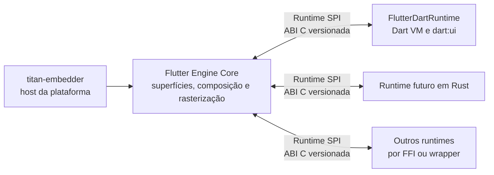

# Estudo: Flutter Engine com SPI de runtime neutro (Dart opcional)

**Data:** 2026-10-14
**Status:** desenho aprovado; implementação futura (meta 3 do `titan-flutter-engine`)
**Escopo:** o contrato entre o núcleo gráfico do engine e os runtimes de UI. A implementação de um framework Rust
fica para outro estudo.

## Contexto

O `titan-embedder` do TitanDM é escrito em Rust e integra o host ao Flutter Engine pela Embedder API C. Essa
fronteira cobre inicialização, superfícies, métricas, entrada, vsync, mensagens de plataforma e apresentação. Ela
**não** torna o runtime Dart opcional: o engine cria a Dart VM e o isolate raiz, e o framework Flutter conversa com o
C++ interno por `dart:ui`.

A meta é que o engine continue executando apps Flutter em Dart e, numa configuração de build alternativa, possa ser
compilado **sem construir, linkar ou empacotar o runtime Dart**. Um runtime futuro, começando por Rust, usaria uma
interface neutra para produzir cenas e semântica. A fronteira não é específica de Rust, .NET, Dart ou de um
framework.

## Objetivos

- Isolar as dependências de Dart num backend opcional.
- Preservar o fluxo e o comportamento dos apps Flutter em Dart quando esse backend está habilitado.
- Definir uma ABI C versionada para runtimes que não dependam de Dart.
- Permitir que outros runtimes usem o núcleo gráfico sem expor tipos privados do engine.
- Manter compositor, sessão, lock e demais processos do TitanDM fora do processo do runtime de UI.

## Fora de escopo

- Implementar agora um framework Flutter em Rust ou em outra linguagem.
- Prometer que pacotes ou código Dart executem em outros runtimes.
- Replicar widgets, layout, animações ou APIs do framework Flutter.
- Isolamento de processos para runtimes neste primeiro desenho.
- Definir todas as primitivas gráficas e serviços de plataforma da ABI em nível de código.

## Arquitetura proposta

| Componente | Papel |
|---|---|
| **Flutter Engine Core** | Integração gráfica comum: superfícies, composição, rasterização e os serviços do SPI. Não depende de `DartVM`, `Dart_Isolate`, `Dart_Handle`, snapshots nem de APIs Dart. |
| **Runtime SPI** | Contrato interno e versionado entre o Core e um backend de runtime. ABI primária em C (sem depender da ABI C++ nem de recursos de uma linguagem): tabelas de funções, estruturas versionadas, *handles* opacos e capacidades negociáveis. |
| **FlutterDartRuntime** | Backend opcional com a Dart VM, os isolates, o `dart:ui` e a ponte entre o framework Flutter e o SPI. É o primeiro backend e mantém os apps Dart existentes; pode ser excluído do grafo de build. |
| **titan-embedder** | Continua sendo o host da plataforma. A Embedder API segue como fronteira para Wayland/KMS, métricas, entrada, vsync, mensagens e apresentação; o SPI não a substitui. |
| **Runtimes futuros** | Rust é a primeira linguagem prevista. O SPI não define o framework Rust nem exige as mesmas APIs de widgets. |

## Build e seleção do runtime

- A opção de build do Dart fica **habilitada por padrão** (comportamento atual).
- Uma opção explícita compila sem o backend Dart. Nesse perfil, o Core não compila, não linka nem distribui a Dart
  VM, o `dart:ui`, os snapshots ou o framework Dart; ele hospeda um runtime que implemente o SPI e não executa apps
  Flutter em Dart.
- A separação precisa existir no **grafo GN e nos artefatos publicados**, não só numa opção de execução que deixa a
  Dart VM linkada no binário.
- O mecanismo de seleção e carga (biblioteca dinâmica, ligação estática ou outro) fica para o protótipo.

No `titan-flutter-engine`, essa opção será uma pasta de patches própria (por exemplo `runtime-spi/`), condicionada
por um argumento de gn, como as demais pastas por assunto.

## Contrato e fluxo de dados

O SPI é bidirecional:

- **Engine → runtime:** ciclo de vida, métricas e remoção de views, eventos de teclado e ponteiro, vsync/deadline,
  mensagens de plataforma e estado de acessibilidade.
- **Runtime → engine:** pedido e submissão de quadros, cenas gráficas, atualizações de semântica, mensagens de
  plataforma, logs e erros.

O runtime constrói a cena com uma API gráfica neutra do engine, que cobre no mínimo composição de desenho,
transformações, recortes, opacidade, texto, imagens e referências a recursos. O engine converte essa representação
para as estruturas internas e continua responsável pela rasterização. Widgets, layout, gestos de alto nível, modelos
de estado e APIs de aplicação pertencem a cada framework: a ABI não expõe widgets Dart nem tipos C++ como `Scene` e
`LayerTree`.

O backend Dart mantém o `dart:ui` para os seus consumidores, mas a implementação interna passa a entregar quadros e
semântica pelo contrato neutro. Um backend Rust usa a mesma ABI por FFI; uma linguagem sem FFI C direto pode usar
*bindings* ou um *wrapper*.

## Versionamento e propriedade de recursos

- Versão maior sinaliza incompatibilidade; versão menor adiciona capacidades compatíveis.
- Estruturas carregam tamanho e versão, para evoluir sem depender do layout de uma linguagem.
- A inicialização negocia capacidades gráficas e de plataforma; o runtime só usa as que o engine anunciou.
- Buffers, cenas e recursos usam *handles* opacos com regras explícitas de retenção e liberação; nenhum ponteiro
  temporário é retido para uso assíncrono.
- Erros atravessam a ABI por códigos e resultados explícitos: panics do Rust e exceções C++/.NET não cruzam a
  fronteira.
- Chamadas do runtime levam identificadores de view e de sequência; quadros têm token e deadline, e submissões
  atrasadas ou de views removidas podem ser descartadas.

## Ciclo de vida e falhas

O host cria, inicia, encerra e libera o backend. Uma falha recuperável encerra o runtime ativo e limpa os recursos;
o host decide se encerra ou reinicia o processo. Uma falha nativa fatal pode encerrar o processo que hospeda o
embedder.

O runtime **nunca** roda dentro do compositor, o que preserva o invariante do TitanDM: se o processo do shell cair, o
compositor mantém a sessão e as janelas; se o processo de lock cair, a tela continua bloqueada
(`ext-session-lock-v1`). O SPI inicial não oferece isolamento de processo; IPC pode vir depois, com os mesmos
conceitos, se houver requisito de conter falhas ou código não confiável.

## O que medir antes de implementar

- Símbolos e objetos da Dart VM em `libflutter_engine.so` e o quanto pesam no tamanho e na RAM do processo
  (alimenta também a meta de otimização de RAM do TitanDM).
- Os caminhos de inicialização que exigem isolate ou snapshot (por exemplo `RuntimeController`, `DartVM`,
  `DartSnapshot`; o patch `linux-musl/0004` já tocou a busca do snapshot).
- As APIs do embedder que pressupõem Dart, direta ou indiretamente.
- A dependência de Dart espalhada por `runtime/`, `shell/` e `lib/ui/`, para estimar o corte dos alvos GN.

## Validação prevista

- Build padrão com Dart continua executando os apps Dart do TitanDM (o probe do QEMU e o `tools/ci.sh engine`).
- Build sem Dart não compila, não linka nem empacota artefatos ou símbolos do runtime Dart (conferido nos artefatos
  finais, não só na inicialização).
- Um runtime de teste valida *handshake*, negociação de capacidades, eventos, métricas, vsync, submissão de cenas,
  semântica, propriedade de recursos e encerramento.
- Um spike Rust consome a ABI C sem tipos privados do engine.
- Testes de falha derrubam o processo que hospeda o runtime e conferem que o compositor mantém a sessão (e, no lock,
  que a tela segue bloqueada).
- Mudanças na ABI são conferidas quanto à compatibilidade entre versões e arquiteturas suportadas.

## Riscos

- As dependências de Dart estão espalhadas por runtime, shell e `dart:ui`; separar os alvos GN pode exigir
  refatoração transversal.
- A representação neutra de cenas é a parte de maior risco: expressiva o bastante para frameworks diversos sem expor
  detalhes do Flutter nem copiar dados a cada quadro.
- Texto, fontes, shaders, imagens, múltiplas views, recursos de GPU e sincronização precisam de contratos de
  propriedade e capacidades explícitos.
- O custo de converter o caminho Dart atual para a cena neutra precisa ser medido, para não haver regressão.
- A distribuição e a seleção dos backends (estática ou dinâmica) ficam para depois de um spike de build e carga.

## Referências (no checkout do engine)

- `engine/src/flutter/runtime/runtime_controller.h` — controlador do runtime.
- `engine/src/flutter/lib/ui/dart_ui.cc` — `dart:ui` e o registro dos *bindings* nativos.
- `engine/src/flutter/shell/platform/embedder/embedder.h` — Embedder API.
- TitanDM: ADR-0002 (shell em processo separado com cena declarativa) e ADR-0003 (embedder Flutter próprio em
  Rust).
